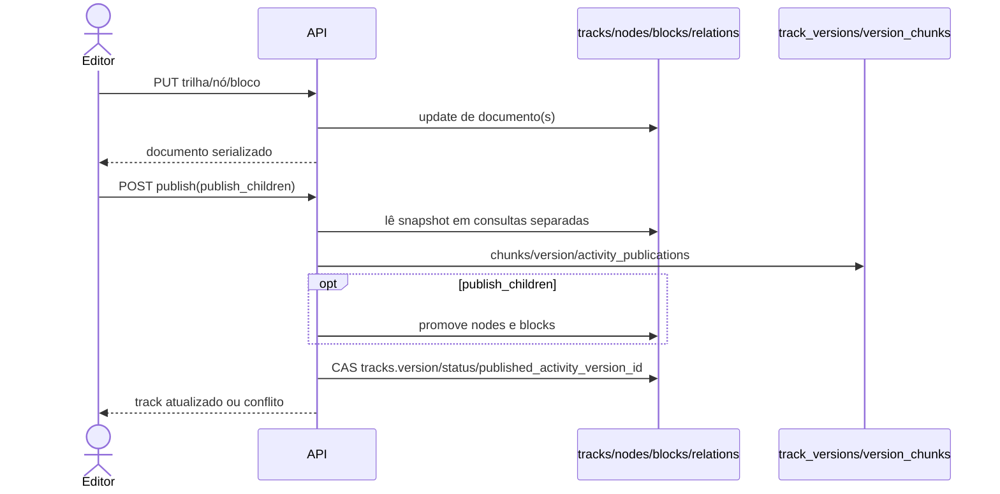
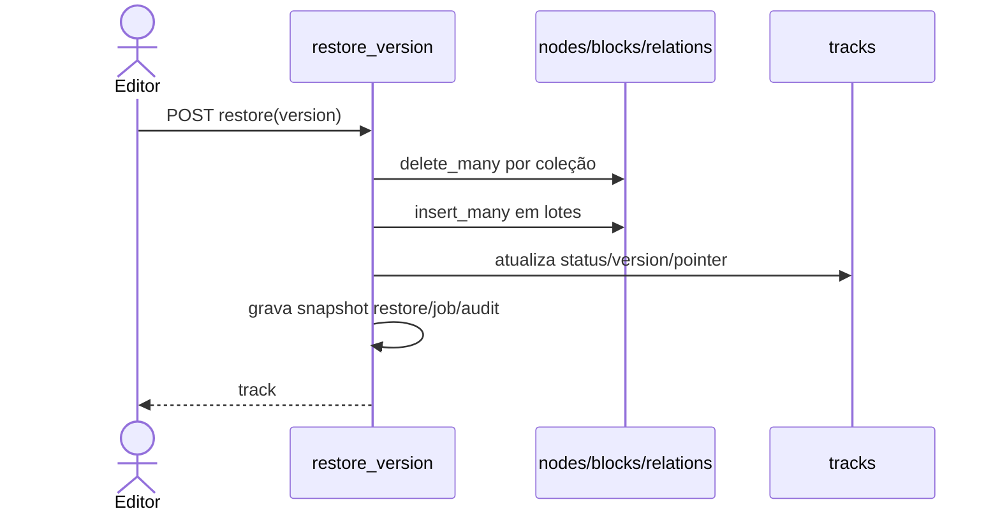
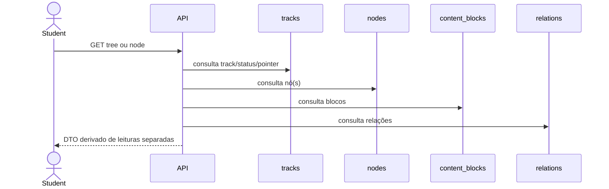
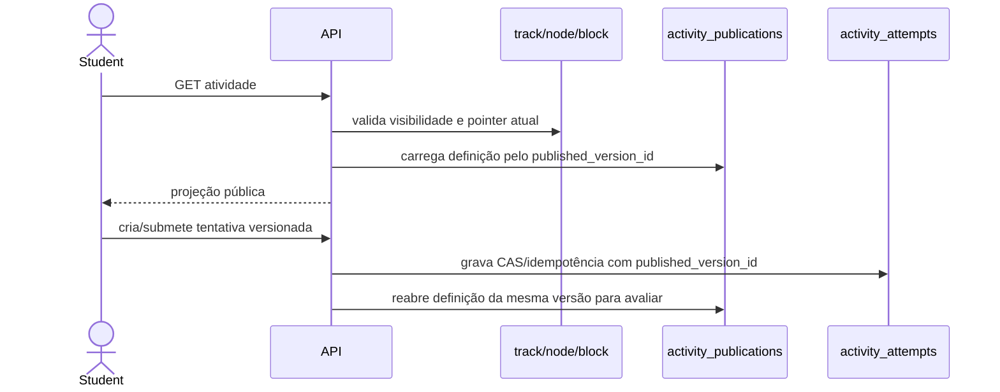
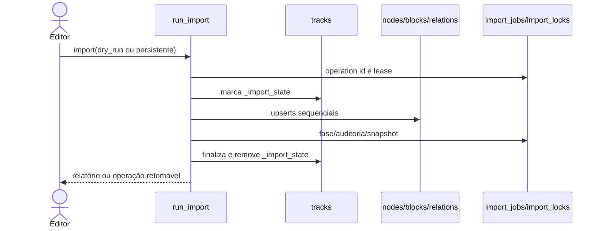
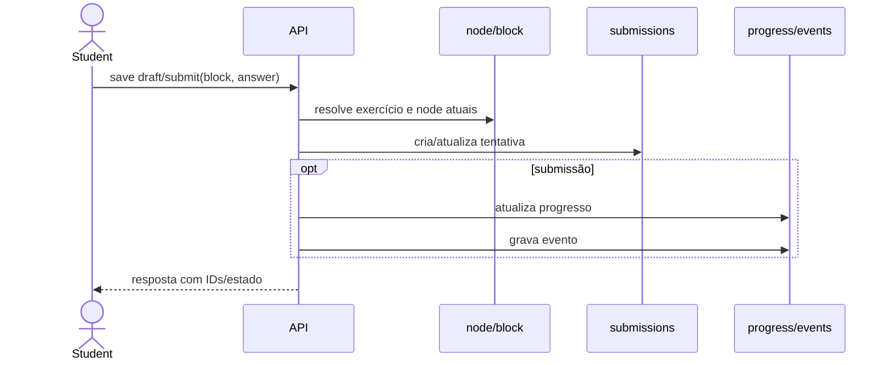

# Fase 2.1A.12B.2 — auditoria da arquitetura editorial

**Status:** auditoria somente leitura. Nenhuma integração foi implementada.
**Snapshot primário auditado:** `e5bf3147a7f9a5ee02e1a011ffcbf1fb7e0cc636`.
**Base da linha editorial nesse snapshot:** `ce427990^1 = 22dca64556338a8fa9aaa89ce627a4f4af72317d`; segundo pai `ce427990^2 = 6440a2b6c80412b0949a4d6614913b05fbea4de4`.
**PoC:** commit `8a087fd5baa9e2eaa98bc1d2ed52b4a60f8c7036`, ancestral do snapshot.
**Leitura remota consultada em 2026-10-28:** `main` = `22dca64556338a8fa9aaa89ce627a4f4af72317d`; `staging` = `fff85218fd71b164dc7465ca72d22b4a53232f49`. O snapshot local inclui commits de integração posteriores à sua base `main`; ele é usado para auditar esses componentes, não como afirmação de que estão implantados.

## 1. Resumo e limites

A aplicação mantém trilhas, nós, blocos e relações em coleções mutáveis separadas. Os leitores atuais consultam essas coleções em várias operações e não fixam uma identidade de publicação para a requisição inteira. A publicação prepara snapshots e atividades antes de atualizar o documento da trilha; com `publish_children=True`, altera o status dos nós/blocos antes do CAS final da trilha. A restauração substitui conjuntos de documentos com `delete_many` seguido de inserções, enquanto leitores continuam vendo o estado publicado da trilha. Esses fatos sustentam risco concreto de visibilidade parcial.

A preparação privada em `services/immutable_publications.py` é deliberadamente não ativável (`activation_eligible=False`), porque não existe disciplina comum de revisão editorial entre os escritores. A PoC homologada valida o protocolo de armazenamento/selagem/seleção em MongoDB 7 standalone, mas seus coletores `poc_*` e leitor experimental não estão ligados às rotas reais. A homologação não prova consistência do snapshot de origem da aplicação.

**Conclusão:** a aplicação não está pronta para ativar leitores por geração. O bloqueio principal não é o CAS do ponteiro; é garantir que todos os escritores produzam uma revisão editorial coerente e que nenhum caminho mutável legado possa contorná-la.

### Escala de evidência

* **Código confirmado:** comportamento diretamente visível no snapshot identificado.
* **Teste confirmado:** há teste que exercita o comportamento citado; não significa cobertura de todas as intercalações.
* **Inferência:** consequência plausível do código sem uma execução concorrente que a prove.
* **Não identificado:** busca estática não encontrou componente; não é prova de inexistência fora do repositório.
* **Decisão:** política de produto/operação que exige aprovação humana.

## 2. Inventário de escritores editoriais

Todas as referências abaixo são do snapshot `e5bf3147…`, salvo indicação. A busca de operações de escrita foi feita nos módulos backend fora dos diretórios de teste. Não foi identificado worker editorial recorrente; `backend/manage.py` oferece comandos explícitos de manutenção.

| Fluxo | Entrada e referências | Escrita / coleções | Transação e concorrência atuais | Efeito e risco | Adaptação necessária |
|---|---|---|---|---|---|
| CRUD e ordenação de trilhas | `routes_content.py:69-95`; `services/tracks.py:51-115` | `tracks` insert/update/delete; reordenação atualiza documentos em loop; exclusão em cascata remove nós, blocos, relações, progresso, eventos, publicações e versões | Sem transação multidocumento; atualizações individuais atômicas, sem revisão editorial compartilhada | Alterações de campos/ordem afetam listagem e leitura. Exclusão em cascata pode deixar estado parcial em falha | Migrar todos os comandos para revisão por trilha; tratar exclusão como tombstone/retirada e preservar progresso/histórico até política aprovada |
| Duplicação de trilha | `routes_content.py:94-96`; `services/tracks.py:118-149` | Insere trilha draft, clona nós e relações com IDs novos | Sequencial, sem transação; falha pode deixar cópia incompleta | Draft parcial administrativo; pode criar órfãos | Construir candidato completo imutável, validar referências e só então registrar a nova raiz/revisão |
| Publicação de trilha | `routes_content.py:99-102`; `services/tracks.py:152-227` | Snapshot/chunks/version, atividades, depois promove nós/blocos e faz CAS no `tracks.version`/estado | Há CAS de versão no documento da trilha no fim; não protege gravações anteriores nem writers de nós/blocos | **P1 confirmado pelo fluxo:** conteúdo filho pode tornar-se público antes da seleção final; snapshot pode ser concorrente | Todos os campos da publicação devem vir de revisão selada; preparar tudo privado e trocar um único head por CAS; não usar status dos documentos vivos como autoridade |
| CRUD e ordenação de nós | `routes_content.py:122-151`; `services/nodes.py:61-82,152-180` | Insert/update; reorder em loop; delete/remove em blocos, relações e progresso | Sem revisão comum/transação; exclusão é multi-coleção | A árvore e páginas de nó podem divergir durante edição; excluir também apaga progresso | Registrar comando em nova revisão; exclusão editorial deve separar tombstone de retenção de dados do aluno |
| Duplicação de nó | `routes_content.py:150-152`; `services/nodes.py:183-232` | Insere cópia de nó/blocos e reorganiza irmãos; força status draft | Sequencial, sem revisão e sem transação | Falha pode deixar cópia incompleta ou ordem concorrente | Cópia completa num candidato; validar novos IDs/relações antes de publicar a revisão |
| CRUD e ordenação de blocos | `routes_content.py:156-175`; `services/blocks.py:12-52` | Insert/update/delete e updates de ordem em `content_blocks` | Sem CAS editorial; delete chama reconciliação depois | Texto, alternativas, critérios e gabaritos podem mudar enquanto leitor consulta vários documentos | Incorporar bloco completo e metadados no mesmo snapshot/versionamento; nunca publicar gabarito via DTO genérico |
| Relações e pré-requisitos | `routes_content.py:177-190`; `services/relations.py:12-50`; validação em `learning.py:116-153` | Insert/update/delete em `relations` | Valida ciclo lendo antes de escrever; duas inserções concorrentes podem passar validações separadas (inferência) | Pode surgir ciclo ou árvore/pré-requisitos inconsistentes | Validar o conjunto de relações do candidato inteiro e usar CAS da revisão para serializar mudanças |
| Importação | `POST /api/import/track` em `routes_import.py:13-36` (dry-run default `true`, limite de corpo 32 MiB); `services/imports.py:70-177,526-815` | Atualiza/cria trilha, nós, blocos, relações e tags; grava jobs, locks, auditoria e snapshots | Lease/operation ID, heartbeat, marca `_import_state`, recuperação/idempotência; não é transação multidocumento | Para o público, `_import_state` esconde a trilha durante aplicação; `can_view_track` deixa staff ler. Writers ordinários não compartilham o fencing do import. Testes cobrem ocultação e retomada | Importar para revisão isolada e selecionar revisão somente após validação; integrar CRUD/restore no mesmo fence; preservar idempotência e relatório |
| Restauração de versão | `routes_versions.py:17-19`; `services/versions.py:24-139,245-332` | `apply_snapshot` apaga nós/blocos/relações e reinsere; atualiza trilha, salva versão restore, job e auditoria | Lease de restore e retomada; sem CAS contra revisão editorial de outros writers | **P1 confirmado:** leitores podem observar coleções vazias/parciais; conflito pode sobrescrever edição concorrente | Restaurar como nova revisão/candidata imutável; validar fonte e executar uma única seleção CAS, sem apagar coleções ativas |
| Taxonomias, tags e tipos de bloco | `routes_taxonomy.py:47-81`; `services/taxonomy.py:31-91` | CRUD `taxonomies`, `tags`, `block_types`; excluir tag faz `$pull` global em tracks/nodes antes de apagar | Operações sequenciais e sem revisão de trilha; não há transação comum | Mudança global pode alterar apresentação, capacidades de envio ou interpretação de conteúdos já publicados | Decidir se são metadados globais versionados separadamente ou referências congeladas por revisão; migração global exige gate próprio |
| Seeds | `backend/seed.py:100-201` | Insere usuários/demonstrações, trilhas, nós, blocos, relações, taxonomias, tipos e tags | Script explícito; `setOnInsert` em metadados, mas conteúdos de demonstração podem ser escritos fora do protocolo | Pode criar/alterar conteúdo fora dos endpoints | Segregar seed somente de desenvolvimento; seed de conteúdo real exige o mesmo command service ou bloqueio por ambiente |
| Migrações e manutenção | `backend/manage.py:18-42`; `backend/migrations/__init__.py:54-99`; `0001_legacy_snapshots.py`; `0002_block_submission_capabilities.py` | Ledger/lease de migration; migração de snapshots e updates em `block_types`; comandos `ensure-indexes`, `preflight-indexes`, `migrate`, `seed`, `resume-restores` | Lease de migration, mas não fence contra writers de conteúdo | Pode alterar interpretação ou conteúdo fora do fluxo de publicação | Exigir janela/compatibilidade, exclusão mútua operacional e migrações aditivas com reversão testada; não executar durante rollout sem aprovação |

### Persistência e índices observados

`backend/database.py:1-8` configura um `AsyncMongoClient` compartilhado, com `tz_aware=True`; não foi encontrado uso de `session.start_transaction`/transação multidocumento no backend auditado. Isso é constatação estática do snapshot, não declaração sobre opções da topologia remota.

`backend/indexes.py:7-91` declara: `tracks.slug` único parcial; `nodes(track_id,parent_id,order)` e `nodes/content_blocks(track_id,meta.import_ref)` único parcial; `content_blocks(node_id,order)`; busca textual de nodes; `activity_publications(track_id,published_version_id,activity_id)` único; `track_publications(track_id,operation_id)` único e índice `state/lease_until`; chaves idempotentes/numeração/tentativa aberta únicas em `activity_attempts`; relação lógica única; `progress(user_id,node_id,block_id)` e `user_track_state(user_id,track_id)` únicos; chave de import em `edit_history`; keys únicas em taxonomies/block_types/tags; submission por user/block/attempt único; notes/reviews com índices de usuário/estado; `version_chunks(version_id,seq)` único; um restore em estado `running` por track; ledger migrations por key. Não há índice de produção declarado para as coleções `poc_editorial_*`; `ensure_poc_indexes` da PoC é namespace isolado (`editorial_generations_poc.py:269-288`). O arquivo de índices mostra especificações; não houve conexão ao DB para confirmar se índices estão criados no ambiente.

### Escritas relacionadas, mas fora do agregado editorial

`activities.py` persiste tentativas do aluno; `progress.py` grava progresso/eventos/estado da trilha; `submissions.py` grava respostas, avaliações, progresso e eventos; `learning.py` grava notas/revisões. Esses dados devem permanecer separados de snapshots editoriais. Eles ainda precisam de uma regra explícita para apontar a revisão/geração usada na atividade e para preservar históricos após exclusão/restauração. `audit.py` escreve `edit_history`, que é trilha de auditoria, não fonte de conteúdo.

## 3. Inventário de leitores

| Leitor | Entrada/serviço e coleções | Identidade e versão | Consistência, projeção e lacunas |
|---|---|---|---|
| Catálogo | `GET /api/tracks`; `tracks.list_tracks` (`routes_content.py:63-68`, `tracks.py:20-48`), `tracks` + contagens de `nodes` | Público autenticado/aluno e staff por permissão; sem generation/version pin | Várias consultas; track e contagens podem refletir momentos distintos. Filtro exclui private e `_import_state` para público. Resposta deriva de documentos vivos |
| Detalhe da trilha | `GET /api/tracks/{id}`; `tracks.get_track` (`routes_content.py:79-82`, `tracks.py:76-80`) | `current_user`, `can_view_track`; sem generation | Retorna documento bruto serializado; sem projeção editorial allowlist específica |
| Árvore | `GET /api/tracks/{id}/tree`; `nodes.get_track_tree` (`routes_content.py:114-120`, `nodes.py:234-256`) | Público/staff; sem generation | Track, nodes, relations e contagem de blocks são lidos em operações separadas. Não há snapshot MongoDB nem geração fixada; relações e estrutura podem misturar estado |
| Detalhe do nó e blocos | `GET /api/nodes/{id}`; `nodes.get_node` (`routes_content.py:132-138`, `nodes.py:27-40,85-149`) | Staff vê draft; aluno verifica visibilidade e status; sem generation | Lê node, locks, blocks, track/pointer de atividade, publicações de quiz, relations e nós relacionados em sequência. Remove notes para aluno; quiz tem caminho seguro; outros tipos de assessment usam denylist. Track/node/block genéricos ainda podem carregar campos extras |
| Busca | `GET /api/search`; `services/search.py:9-47`, `integrity.visible_ids` | Conforme visibilidade do usuário; sem generation | Pesquisa nós vivos e depois resolve títulos de trilha em consultas separadas; pode straddlar publicação/edição |
| Validação e pré-requisitos | `GET /api/tracks/{id}/validate`; `learning.validate_track`, `track_locks` | Staff content.read ou aluno no cálculo de lock | Carrega track/nodes/relations/blocks/progress separadamente; sem identidade de revisão única |
| Atividade/quiz público | `GET /api/activities/{id}/attempts` e `POST /attempts`; `activities._active_publication` | Estudante; quiz usa `activity_publications` com `published_version_id`; definição privada contém resposta | Atividade já é versionada por publicação; `public_activity` projeta campos para aluno. A leitura também consulta node/track vivos e exige visibilidade atual. Versão da atividade não é identidade completa do resto da trilha |
| Avaliação/tentativa | Rotas `/api/activities/...`; `activities._publication_for_attempt`, submit/evaluate | Aluno/staff autorizado; tentativa fixa `published_version_id` e `activity_revision` | Avaliação de quiz usa definição versionada da tentativa. A projeção da tentativa permite campos específicos, mas o conteúdo de nó pode ter mudado. Bom precedente, ainda limitado por atividade |
| Progresso | `/api/progress`, `/visit`, `/tracks/{id}`, `/overview`, `/history`; `progress.py` | Aluno autenticado; progresso chaveado por user/node/block, não geração | Resolve nó/bloco vivos para autorização/estado. Updates têm revisão/idempotência e reconciliação de evento; não preservam qual snapshot não-quiz foi consumido |
| Submissões | `/api/submissions/*`; `submissions.py:20-204` | Aluno/staff grading | Submission guarda IDs e alguns títulos/tipos, mas não snapshot/version ID; detalhe faz join com bloco/nó vivos. Rubrica/capacidade pode ser alterada globalmente |
| Notas/revisões | `/api/notes`, `/api/reviews`; `learning.py:175-370` | Privado por usuário; nota usa CAS/versionamento; review usa identidade/estado do aluno | Não deve entrar em geração editorial. Títulos associados são resolvidos a partir do nó atual, que pode mudar |
| Versões e preview administrativo | `GET /tracks/{id}/versions`, `/versions/{id}`, `/compare`, `track_tree` staff; `versions.py:142-227`, `integrity.py:63-122` | `content.read`; leitura de versões salvas/chunks ou estado atual | Snapshot histórico imutável por convenção/hash, mas `save_version` substitui manifesto e `store_snapshot` apaga chunks prévios para o mesmo id; atual snapshot corrente não é snapshot consistente |
| Metadados | `GET /api/meta`; `taxonomy.get_metadata` | Usuário autenticado; coleções globais de taxonomies/block_types/tags | Sem pin de revisão; alteração de block type pode mudar capabilities ou visualização sem nova geração |
| Frontend/cache | `useTree`, `useNodeDetail`, `useTrackProgress` em `frontend/src/hooks/useData.ts:19-40`; React Query em `frontend/src/index.tsx:41` | Cache por trackId/nodeId, não geração; staleTime 30s, sem refetch on focus | TrackViewer combina árvore e progresso e NodeReader obtém detalhe separado; cache pode manter mistura ou versão antiga até invalidar |

Não foi encontrado endpoint explícito de exportação de conteúdo nem cache HTTP/CDN declarado na área auditada. Isso é “não identificado no snapshot”, não garantia de inexistência fora dele.

## 4. Fluxos atuais observados

## 5. Reavaliação do risco P1

| Cenário e sequência | Evidência / estado possível | Impacto e classificação | Garantia e regressão necessárias |
|---|---|---|---|
| Publicar trilha já publicada com filhos draft: grava snapshot, publica activity rows, marca filhos `published`, depois CAS do track perde para outro publish | `tracks.py:207-225`; os filhos são publicados antes do filtro CAS; rotas públicas consultam status vivo em `nodes.py:85-149`. **Código confirma a janela; concorrência que perde o CAS é inferência testável** | Conteúdo novo visível sob versão/pointer anterior; **P1** | Falha injetada após cada gravação; leitor antes/depois só resolve head antigo ou novo completo; nenhuma alteração de documento ativo durante preparo |
| Captura de snapshot cruza edição de campo sem mudar contagem | `versions.snapshot_track:142-159` compara apenas counts pré/pós; `update_track/node/block/relation` não incrementa `editorial_revision` comum | Snapshot pode conter valores lidos em tempos distintos; **P1, possível pelo mecanismo** | Dois escritores concorrentes editando documentos distintos; gerar hash/snapshot e provar revisão monotônica comum; alteração de campo deve invalidar candidato mesmo com contagem estável |
| Restore de trilha publicada: apaga coleção e reinserção falha/interrompe | `versions.apply_snapshot:245-257`; track status é alterado no final em `:101-118`; leitores consultam coleções vivas | Árvore/blocos vazios ou parciais enquanto track continua publicada; **P1 confirmado pela sequência** | Failpoints depois de cada delete/lote; leitor público nunca consulta estado mutável intermediário; seleção de snapshot completo por um único CAS |
| Leitor faz tree + node em chamadas distintas e publicação ocorre entre elas | `useData.ts:19-40`, `TrackViewer.tsx`, `NodeReader.tsx`; services fazem várias consultas | UI mistura árvore de A e detalhes de B ou usa IDs removidos; **risco inferido fortemente** | Cada resposta inclui identidade opaca de geração; APIs internas recebem/preservam generation token; teste de intercalação multi-endpoint e cache |
| Quiz passa de versão enquanto aluno responde | `activities.py:128-196,208-267,306-451`; tentativa fixa versão publicada e avaliação reabre a mesma publicação | Proteção existente para definição do quiz; relação com nó/progresso permanece atual e depende de política | Manter publicação de atividade antiga retida; testar submissão iniciada antes da troca, avaliada depois contra versão fixada; definir quando versão é expirada |
| Submission genérica atravessa mudança de conteúdo/rubrica | `submissions.py:20-30,73-113,171-204`; sem generation/version id e join de bloco atual | Resposta pode ser corrigida/interpretada usando conteúdo diferente do visto; **inferência** | Persistir referência à geração e rubrica imutável no início da tentativa; teste mudança de revisão entre draft, submit e grading |
| Erro de projeção de campos privados em schema permissivo | `schemas/content.py:116-145` permite `extra="allow"`; `serialization.py:8-41` remove credenciais, não aplica allowlist geral. Quiz tem projeção específica | Campo interno futuro pode ser serializado por retorno raw; existência de gabarito exposto na rota atual não foi demonstrada | DTOs públicos estritos por tipo de bloco e geração; teste property-based com campos privados/canários e contratos de API |
| Import parcial | `imports.py` marca `_import_state`; `test_import_workflow.py:78-204` testa ocultação e retomada | Público tem guarda existente; staff pode ver state parcial e outros writers não compartilham fence; **risco residual** | Import produz revision isolada, comandos usam mesmo fence; testes de concorrência entre import, edit, restore e publicação |
| CAS de head separado de writers de conteúdo | `editorial_revision` não é mantido pelos CRUD atuais; PoC de publicação define `activation_eligible=False` | CAS do ponteiro não prova origem coerente nem impede escrita legado após snapshot; **confirmado como lacuna** | Head/control por trilha recebe todo comando editorial; bloqueio dos bypasses antes de ativação |

### Evidência de testes existente

* `backend/tests/test_activity_attempts.py:126-155` testa falha de quiz inválido sem ativar publicação parcial; `:158-212` cobre conflito e tentativa antiga fixada.
* `backend/tests/test_import_workflow.py:78-245` cobre import publicado interrompido, ocultação pública e recuperação/reimportação idempotente.
* `backend/unit_tests/test_immutable_publications.py:239-387` cobre preparação privada, hash, retry e bloqueio da elegibilidade.
* `backend/integration_tests/test_editorial_generations_mongodb.py` e `backend/unit_tests/test_editorial_generations_poc.py` validam protocolo isolado; não chamam as rotas reais.
* Esses testes confirmam guardas específicas; não provam ausência de toda intercalação de produção.

## 6. Compatibilidade e dados preservados

IDs atuais de track/node/block/relation devem continuar estáveis para não quebrar URLs, progresso (`progress` unique user/node/block), tentativas (`activity_attempts` guardam track/node/activity e `published_version_id`), submissões, notas, reviews e imports pendentes. `track_versions` e `version_chunks` devem ser preservados durante coexistência e retenção. A auditoria não recomenda apagar ou reescrever conteúdo legado no cutover.

O progresso genérico não está associado à versão; tentativas de quiz estão associadas ao `published_version_id`; submissões genéricas não carregam geração. Política de continuidade deve ser decidida antes de ativar novas leituras: continuar tentativa antiga contra sua definição original, migrar progresso semanticamente, ou exigir reinício somente para tipos que não têm definição histórica. Nunca reatribuir IDs existentes para simular uma revisão.

## 7. Escopo e limitações da evidência

* Código principal examinado em `e5bf3147…`, que inclui a branch de integração de atividades pela merge-base `ce427990…`; o remoto `main` consultado continua no commit `22dca645…`, ancestral desse snapshot. O objeto do `staging` consultado (`fff85218…`) não é ancestral de `e5bf3147…`; a comparação de árvores nas áreas técnicas identificou diferenças em `indexes.py`, `integrity.py`, `learning.py`, rotas de import/progresso/atividade, serviços de atividades/import/progresso/submissões/nodes/tracks/versions e componentes/hooks/types de frontend. A auditoria detalhada linha a linha usa `e5bf3147…`; não afirma que a divergência inteira do `staging` foi auditada ou que o snapshot esteja implantado.
* `staging` remoto consultado = `fff85218…`; não foi feito checkout, merge, deploy ou chamada de aplicação.
* API GitHub somente leitura confirmou que run `40686021030` está `completed/success`, `workflow_dispatch`, tentativa 1, SHA de executor `bf081932…`; histórico retornou 3 runs. A informação de 26 unitários/15 integrados/7 guardas/cleanup vem do resultado fornecido para esta fase; logs não foram reexecutados.
* O executor remoto consultado estava no HEAD `701b314…`, lock com `transport.enabled:false`. Nenhuma escrita foi feita.
* Não houve MongoDB, Docker, Actions ou dados reais acessados nesta auditoria.
