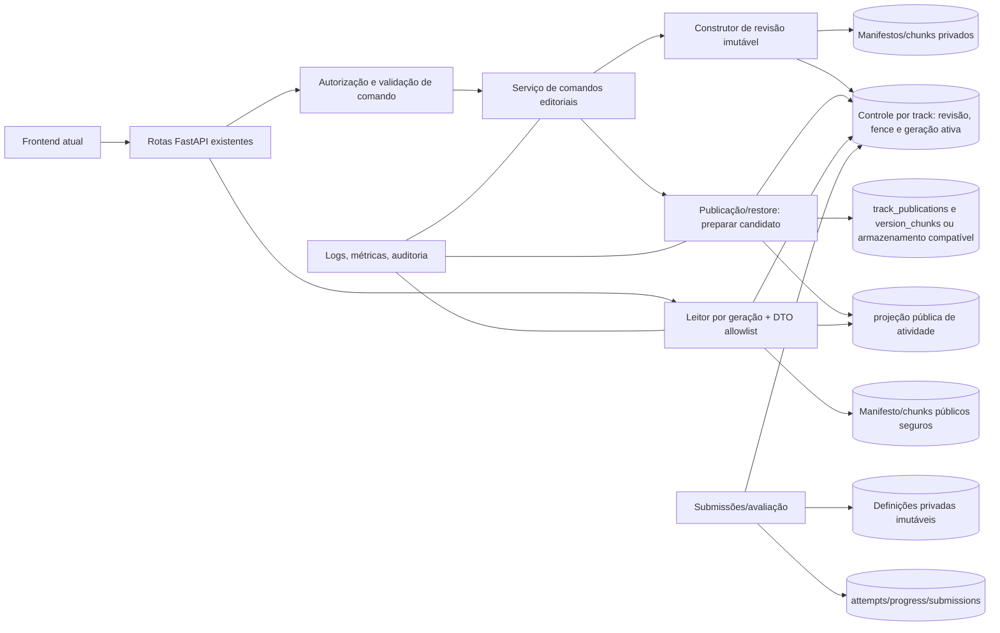
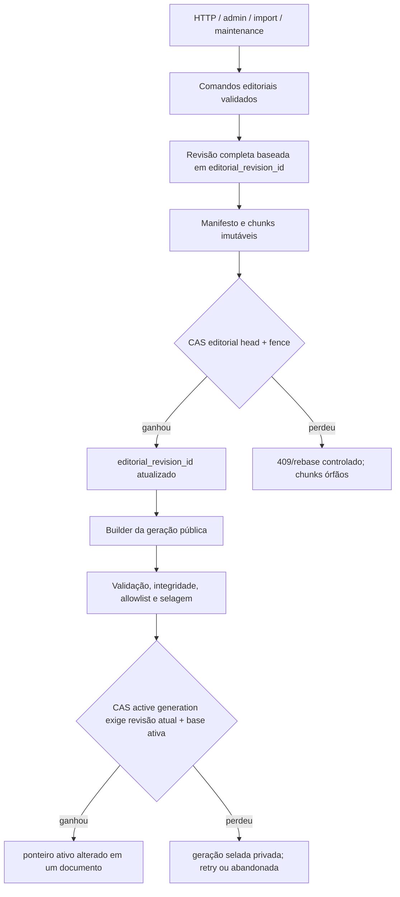
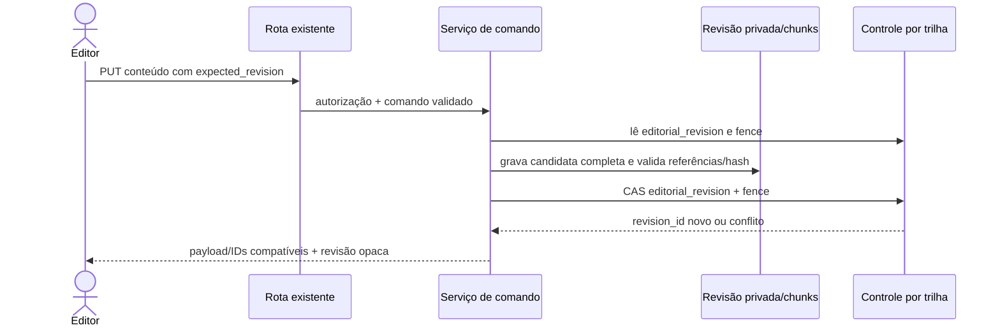
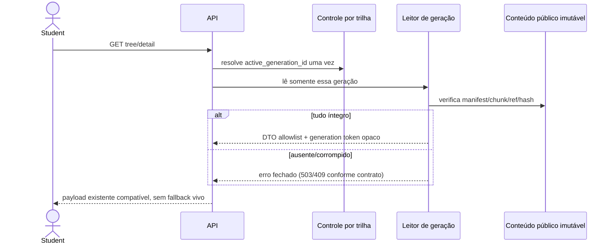
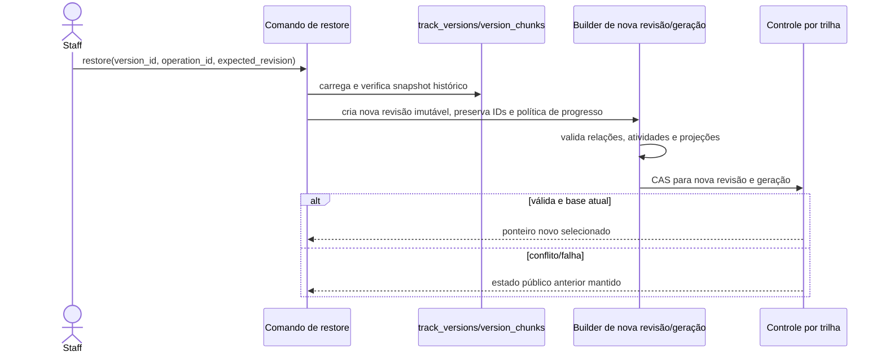

# Fase 2.1A.12B.2 — arquitetura alvo e contratos de integração

**Natureza:** proposta conceitual; não implementada. **Base técnica auditada:** `e5bf3147a7f9a5ee02e1a011ffcbf1fb7e0cc636`. **PoC:** `8a087fd5baa9e2eaa98bc1d2ed52b4a60f8c7036`, homologada no run `40686021030` informado/consultado como `completed/success` em MongoDB 7.0.45 standalone.

## 1. Princípios e decisão arquitetural central

A aplicação deve manter dois conceitos independentes:

1. **Revisão editorial:** estado privado coerente que o editor pode alterar; não é público.
2. **Geração publicada:** projeção pública imutável, validada e selecionada; não acompanha alterações posteriores no rascunho.

Uma geração publicada não é equivalente a uma versão numérica no documento `tracks`. A identidade deverá ser explícita e estável, e leitores devem resolvê-la uma vez no começo da operação. Restaurar cria uma nova revisão e nova geração; não reescreve o conteúdo da geração antiga.

### Resposta obrigatória: consistência de origem

CAS somente no ponteiro publicado **não** garante que o snapshot tenha sido composto de uma revisão editorial coerente. Os escritores atuais alteram documentos diferentes sem atualizar uma revisão comum. A abordagem proposta é um agregado lógico por trilha com revisões completas imutáveis e uma única linha de controle por `track_id`:

1. Ler `editorial_revision_id` e `revision/fence` do controle da trilha.
2. Aplicar o comando sobre o snapshot imutável exato daquela revisão; validar o agregado completo.
3. Gravar chunks/manifests imutáveis com identidade de operação e hashes. Esses objetos ainda não são selecionáveis.
4. Confirmar a nova revisão com CAS **no documento de controle da trilha**, filtrando revisão-base e fence. Dois comandos da mesma base não podem vencer; o perdedor recebe conflito e rebaseia/reaplica o comando explicitamente.
5. Preparar a geração pública a partir de uma `editorial_revision_id` exata, nunca de consultas às coleções vivas.
6. Selar e validar a geração; então CAS no mesmo controle, exigindo `editorial_revision_id` capturada, `active_generation_id` e `active_revision` esperados. A atualização atômica muda o ponteiro público somente se a revisão editorial ainda for a candidata pretendida.

O documento de controle é o ponto de serialização; o conteúdo fica em objetos imutáveis antes do CAS. Falhas deixam órfãos não selecionáveis, não conteúdo parcialmente ativo. Isso funciona sem transação multidocumento, desde que **todos** os escritores usem o protocolo. A política de conflito (409, rebase automático seguro, ou fila por trilha) requer decisão; não se deve silenciosamente aplicar um patch de campo sobre uma base que mudou.

Durante coexistência, coleções vivas não podem continuar sendo fonte de verdade pública após ativação. Projetá-las assincronamente como read model é possível, mas o leitor não pode fazer fallback para uma projeção parcial ou antiga. A transição de cutover exige que writers e readers estejam cercados por capability/feature gates e que os caminhos legados não consigam alterar a origem após a revisão ser confirmada.

## 2. Matriz atual × PoC × produção

| Responsabilidade | Atual no snapshot auditado | Mecanismo da PoC / preparação | Lacuna e adaptação proposta |
|---|---|---|---|
| Identidade | `tracks.version`, `published_activity_version_id`; versão numérica | `generation_id`, `base_generation_id`, `generation_revision` e IDs de operação | Definir identidade de geração pública e revisão editorial, mantendo IDs de track/node/block; não reutilizar `version` como único token |
| Escrita editorial | Serviços atualizam coleções vivas separadas | Candidate por operation/writer e snapshot canonicalizado | Converter CRUD, reorder, duplicate, delete, import, restore, taxonomias relevantes, seeds/manutenção para o mesmo controle/fence antes da ativação |
| Coerência da captura | `snapshot_track` lê track/nodes/blocks/relations e compara só contagens (`versions.py:142-159`) | PoC aceita um snapshot fornecido | Snapshot deve derivar de uma revisão imutável; o coletor legado não atende o requisito |
| Construção privada | `track_publications` prepara snapshot privado, hash e atividade inativa (`immutable_publications.py:461-618`) | Geração `building` + chunks | Manter estágio privado; substituir a fonte viva pela revisão exata; rever schema/estado sem transformar PoC em código de produção diretamente |
| Chunks/manifests | `version_chunks` e `track_publications` existem | Sequência, hash de chunk, hash de conteúdo, manifest e verificação de volta | Reutilizar `version_chunks` para payload privado/histórico se limites e retenção forem adequados; introduzir armazenamento público separado se necessário para privilégios e projeção física |
| Selagem | `prepared`, ainda não ativável; `activation_eligible=False` | Intent de selagem, manifest imutável e retry | Especificar invariantes de imutabilidade em production service, índices e privilégios; impedir `replace/delete` depois do selo |
| Seleção | Publicação atual CAS em `tracks.version`, mas mutações precedentes | CAS em documento head com base/revisão, receipts limitados | Controle interno único por track; CAS condicionado também à revisão editorial atual; recibo bounded e replay idempotente |
| Leitura | Rotas resolvem documentos vivos separadamente; atividade tem versão | `read_active_public` fixa head uma vez e falha fechado | Migrar árvore, detalhe, catálogo, busca, metadados usados no render, atividades e avaliação; sem fallback a coleções vivas após cutover |
| DTO | Pydantic `extra="allow"`, serializer genérico; quiz tem projeção | Projeção explícita por tipo | Criar allowlist versionada por `block_type` e versão de schema; separar fisicamente resposta/gabarito do snapshot público |
| Idempotência/fencing | Import e restore têm leases locais; CRUD comum não | operation fingerprint, lease, fencing token, CAS, replay | IDs de operação por comando; fencing compartilhado no agregado, inclusive manutenção/import/restore; operações idempotentes não aceitam conteúdo divergente sob mesma chave |
| Atividade | `activity_publications` private/public fields juntos, tentativa fixa `published_version_id` | Referências de atividade no manifesto e DTO público | Vincular atividade à geração (e manter versão histórica); separar definição privada da projeção publicável para menor privilégio por coleção |
| Falha/recuperação | Imports retomáveis, restores retomáveis, mas mutações podem estar parciais | estados building/sealed/abandoned e recuperação por operação | Recovery worker ou comando controlado que valida owner/fence/hash; nunca selecionar estado parcialmente construído |

## 3. Componentes alvo

Os nomes são ilustrativos. Deve-se primeiro confirmar a forma de dependency injection do backend e os limites dos serviços existentes. A aplicação já tem rotas FastAPI, serviços e um único cliente `AsyncMongoClient` configurado em `backend/database.py:1-8`; a proposta não implica criar microsserviços.





## 4. Sequências futuras separadas das atuais



```mermaid
sequenceDiagram
  actor Editor
  participant API
  participant Pub as Builder/validador
  participant Store as Revisões, manifests, chunks e atividades privadas
  participant Head as Controle por trilha
  Editor->>API: publish(operation_id, expected_revision)
  API->>Pub: carrega revisão imutável exata
  Pub->>Store: prepara geração e dados versionados de atividade
  Pub->>Store: valida hash, schema, referências e DTO público
  Pub->>Store: sela manifest (privado)
  Pub->>Head: CAS editorial_revision + base ativa + fence
  alt CAS aceito
    Head-->>Pub: generation_id ativo
  else CAS obsoleto
    Head-->>Pub: conflito; geração selada não selecionável
  end
  Pub-->>API: recibo idempotente
  API-->>Editor: contrato existente com versão/IDs estáveis
```





## 5. Contratos conceituais

Nenhum contrato abaixo altera a API pública nesta fase. `expected_revision` pode ser interno/administrativo até se decidir como transportá-lo sem quebrar clientes.

| Operação | Entrada / saída | Pré e pós-condições | Consistência, acesso e erros | Retry / compatibilidade |
|---|---|---|---|---|
| `begin_editorial_command` | track ID, operation ID, writer ID, expected revision, tipo e fingerprint → lease/fence/base revision | Track existe; identidade autorizada; mesma chave com mesmo fingerprint retorna operação; conteúdo diferente conflita | Acesso editorial; lease por agregado; erro de conflito, lease ocupado, não autorizado | Idempotente por `(track_id, operation_id)`; lease expiry só via takeover com fence crescente |
| `read_editorial_revision` | track ID + revision ID → snapshot completo interno | Revisão sealed, escopo de track correto e hashes íntegros | Privado; ausência/corrupção falha fechado | Read-only; nunca fallback para coleções vivas |
| `prepare_editorial_revision` | revisão-base, comando/patch, operation ID, fence → revision candidate | Patch aplicado sobre snapshot exato; IDs/referências validados; limites BSON/chunks atendidos | Escreve objetos privados append-only; conflitos de campo/revisão não são resolvidos por last-write-wins | Replay same fingerprint; mudança de payload com mesma operação = conflito |
| `seal_editorial_revision` | candidate ID + validação → revision sealed | Todos chunks sequenciais e hash válidos; referências fechadas; escritor mantém fence | Append-only manifesto; estado não mutável após sela | Retry retorna mesma sela; candidato incompleto nunca é selecionável |
| `prepare_public_generation` | revision ID, publish options, operation ID → geração privada + relatório | A revisão é sealed; validação pedagógica, relações, schema de bloco e projeção completa passam | Builder privilegiado; dados não aparecem em leitor público | Idempotente; mesma operação/conteúdo retorna candidato; alteração conflita |
| `seal_generation` | candidate ID → manifest sealed | Manifesto aponta exatamente chunks/activity refs e hashes; no caminho público só DTO seguro é persistido | Escrita imutável; falha de integridade bloqueia seleção | Retry idempotente; estado sealed nunca é editado |
| `select_generation` | track ID, generation ID, expected editorial revision, expected active generation/revision, operation ID/fingerprint, fence → receipt | Candidata sealed e íntegra; head ainda corresponde à revisão/base; operação não excedeu recibos | Um único update CAS no documento de controle; erro de obsoleto, fence, corrupção ou limite de receipt | Retry após resposta perdida lê receipt; chave reutilizada com conteúdo diverso conflita |
| `resolve_active_generation` | track ID → generation ID + revision/hash | Ponteiro existe e aponta a manifesto completo | Leitor público somente metadata segura | Resolver exatamente uma vez por operação; nenhum fallback |
| `read_generation` | generation ID + IDs/page → DTO de domínio estável | Cada chunk/reference/hash validado; todas consultas filtram generation ID | Role de leitura segura; corrupção retorna erro fechado, não resultado parcial | Pode paginar sob token generation fixo; cache key inclui generation ID |
| `project_public_content` | snapshot privado + block type/schema version → DTO público | Allowlist específica para cada bloco; avaliação privada separada | Nenhuma resposta/gabarito/campo administrativo em saída; erro para tipo desconhecido | Versão da projeção fixa no manifest; versão desconhecida é indisponível, não passthrough |
| `restore_generation` | version ID, expected revisions, operation ID → nova revisão/generation + receipt | Histórico íntegro; política de IDs/progresso definida; restore é nova operação | Não executa delete/reinsert em coleções públicas; preserva head antigo até CAS | Idempotente; retry retorna mesmo resultado; conflito não apaga conteúdo |
| `recover_operation` | operation ID/track ID → estado/ação | Confirma dono/fence/status e hashes; não adivinha fase ausente | Serviço interno de manutenção com auditoria | Retoma só transições documentadas; candidatos inválidos abandonados, nunca ativados |

## 6. Persistência e índices candidatos

Os nomes seguintes são propostas, não objetos criados. Primeiro avaliar reuso real:

* **Reutilizar potencialmente:** `version_chunks` (índice único existente `(version_id, seq)`), `track_publications` (índices por `(track_id, operation_id)` e recovery de lease), `activity_publications` e `track_versions` para histórico compatível.
* **Não reutilizar sem contrato:** `track_publications` é preparação de publicação e pode sofrer transições; revisão editorial de cada comando é conceito distinto. `track_versions` não é manifest imutável garantido: `save_version` usa replace; `store_snapshot` apaga chunks anteriores do mesmo version_id.
* **Possíveis coleções novas justificadas:** `editorial_revisions` (manifestos privados de revisão), `editorial_control` (um doc por track com `editorial_revision_id`, active generation, revisions, fence e receipts limitados), `public_generation_manifests` e `public_generation_chunks` (projeção sem segredos se necessário por privilégio de coleção), `activity_evaluation_definitions` (segredo isolado da projeção de atividade pública). Antes de duplicar chunks, validar se um `version_chunks` compartilhado consegue manter identidade, política de append-only, retenção e divisão de acesso sem exposição.

Campos conceituais de `editorial_control`: `track_id`, `editorial_revision_id`, `editorial_revision`, `active_generation_id`, `active_generation_revision`, `head_revision`, `fencing_token`, `lease_owner/lease_until` quando necessários, bounded `operation_receipts`, `updated_at`. Não incluir esse documento em `TrackOut` nem expô-lo pelo serializer genérico.

Manifesto da revisão/geração: `track_id`, IDs de revisão base e candidata, `operation_id`, fingerprint, `writer_id`, `schema_version`, `state`, `content_hash`, `manifest_hash`, timestamps, `generation_revision`, chunks ordenados por sequência/hash/tamanho, refs de atividades e validação. `building → sealed` ou `abandoned`; `sealed` imutável. `prepared` é distinto de geração selada; `active` é relação do head, não estado mutável do manifesto.

Índices candidatos a validar antes de migração:

| Coleção | Índice lógico |
|---|---|
| `editorial_control` | unique `track_id` |
| `editorial_revisions` | unique `(track_id, revision_id)`; unique `(track_id, operation_id)` |
| `public_generation_manifests` | unique `(track_id, generation_id)`; unique `(track_id, operation_id)` |
| chunks | unique `(storage_id, seq)`; opcional índice para localizar geração e fence sem admitir colisão de storage ID |
| atividade privada/publicada | unique `(track_id, generation_id, activity_id)` e refs para manifest |

Tamanho: nenhum snapshot inteiro deve ser colocado num documento perto do limite BSON. Definir máximo de snapshot, chunk, quantidade, profundidade e bloco; rejeitar antes de selar. Nunca confiar somente em contagens: verificar hash por chunk, hash canônico de conteúdo, hash de manifesto, quantidade/sequência, todas referências, IDs e schema. Retenção deve preservar gerações ativas e referenciadas por tentativas/submissions; excluir somente após regra e auditoria.

MongoDB standalone: operações de CAS em um documento são atômicas. Inserções de chunks/manifests em vários documentos não são atômicas; ordem de protocolo, imutabilidade, verificação e seleção tardia tornam a falha segura. Nada aqui depende de transaction multi-document. Se uma evolução exigir atomicidade entre documentos, replica set/topologia e suporte passam a ser decisão de infraestrutura separada, não pressuposto desta proposta.

## 7. Identidades, projeção e segurança

O código auditado usa um cliente/URI de aplicação (`backend/database.py:1-8`); roles MongoDB efetivamente configuradas não puderam ser verificadas sem acesso ao servidor/segredos, e nenhum acesso a banco foi feito. Princípio proposto:

| Papel lógico | Acesso mínimo proposto |
|---|---|
| Serviço editor | Pode solicitar comandos através da camada autorizada; não recebe acesso indiscriminado de update a chunks selados |
| Builder | `find/insert` em chunks/manifests de preparação; mudanças de estado somente via protocolo/controles delimitados; sem update/delete do payload imutável |
| Seletor | CAS/update apenas em documento de controle e receipts necessários; leitura/verificação do candidato; sem mutação de payload selado |
| API pública | `find` apenas em manifest/chunks de projeção pública, catálogo safe e recursos públicos; nenhum acesso a definição de gabarito/rascunho |
| Avaliador | Lê definição privada versionada e tentativa; não administra conteúdo nem altera manifesto |
| Leitor administrativo | Lê revisões privadas mediante autorização `content.read`; nunca recebe segredo de usuário/credencial de sistema |
| Manutenção/backfill | Identidade separada, janela controlada, logs auditáveis; migração não compartilha credenciais interativas |

MongoDB grants são principalmente por coleção, não permitem filtro de documento/field equivalente a uma allowlist de linha. Portanto, dados de resposta correta não devem residir no mesmo conjunto que a identidade da API pública se a separação de privilégio no banco for requisito. O serviço também deve aplicar DTO estrito: o padrão atual `extra="allow"` em `schemas/content.py:116-145` e serializador genérico em `serialization.py:8-41` não é uma allowlist de conteúdo. Definição avaliativa privada e projeção de aluno devem ser armazenadas/acessadas separadamente; bloco desconhecido deve falhar fechado.

Proteger: gabarito/feedback/rubrica, manifest hash de controle interno, writer/fence/lease/receipt, source revision administrativa, rascunhos, dados de usuário, respostas e notes. Erros ao público não devem incluir payload, URI, hash privado ou estado detalhado de lease.

## 8. Frontend, APIs e progresso

### Contrato existente observado

`TrackViewer` compõe `/tracks/{id}/tree` com progresso; `NodeReader` pede `/nodes/{id}` em query separada. React Query chaveia por `trackId`/`nodeId` e tem `staleTime=30_000`, sem refetch de foco. Catálogo usa `/tracks` e `/progress/overview`. Quiz já envia `published_version_id`, chave idempotente e `expected_revision`; a API retorna tentativas versionadas. Manter IDs existentes e formato atual de campos durante migração reduz risco; geração deve ser token opaco aditivo e opcional na compatibilidade inicial, e depois obrigatória apenas para clientes compatíveis.

### Política proposta para sessão/progresso

Opções dependentes de produto:

1. **Sessão fixa:** aluno fica na geração em que abriu a trilha; tentativa e progresso registram generation ID. Bom para consistência; requer disponibilidade/retention da geração antiga.
2. **Troca explícita:** aluno recebe aviso de nova revisão; continua até terminar atividade iniciada, mas navegação seguinte resolve a nova geração. Exige semântica para progresso de IDs removidos.
3. **Sempre ativa:** cada request resolve head novo. Menos state no cliente, mas árvore, node e quiz podem mudar entre requisições. Não recomendada sem token de geração retornado e preservado.

Recomendação inicial: geração fica fixada por sessão de trilha e por tentativa, transportada como token de leitura (query/header interno compatível) e incluída nas query keys/cache. Tentativa de quiz usa sua definição imutável mesmo após nova publicação; isso alinha com o mecanismo já existente em `activities.py`. Progresso genérico deve conservar chaves atuais e receber um novo campo generation/revision opcional, não migrar identidade existente no cutover. Submissões abertas devem fixar geração e rubrica; grading consulta definição versionada. Decidir prazo de retenção antes de remover geração antiga.

Progresso órfão não deve ser apagado como efeito colateral da exclusão editorial. Avaliar tombstone de conteúdo e consulta histórica; não reusar IDs. Notas/reviews permanecem dados privados do usuário, referenciados por IDs legados; título e breadcrumb podem ser projetados com metadados históricos preservados ou indisponibilidade explícita.

## 9. Decisões humanas necessárias antes de implementação

1. O que significa publicar “o último estado”: exigir que a revisão editorial ainda seja head no CAS ou permitir publicação explícita de revisão histórica.
2. Escrita concorrente: responder conflito e exigir rebase, rebase automático de comandos declarativos, ou fila por trilha.
3. Taxonomias, tags e `block_types`: globais independentes versionados, ou incorporados/fixados em cada geração.
4. Política para alunos após republicação: session pin, troca explícita ou sempre ativa; implicações em tentativa e progresso.
5. Retenção de atividades/gerações antigas enquanto houver tentativa/submissão/referência histórica.
6. Exclusão/arquivamento: tombstone, retenção de progresso e janela de restauração.
7. Separação física de chunks públicos e privados versus API backend trusted com DTO; recomendada separação para resposta/gabarito.
8. Se a geração global da trilha é o limite correto ou se atividades podem ser publicadas independentemente.
9. Como versões históricas, restaurações e imports devem aparecer no histórico já consumido pelo frontend.
10. Topologia MongoDB e roles de CI/staging/produção a serem aprovadas por operações; PoC standalone não valida política de cluster/backup/retention.
