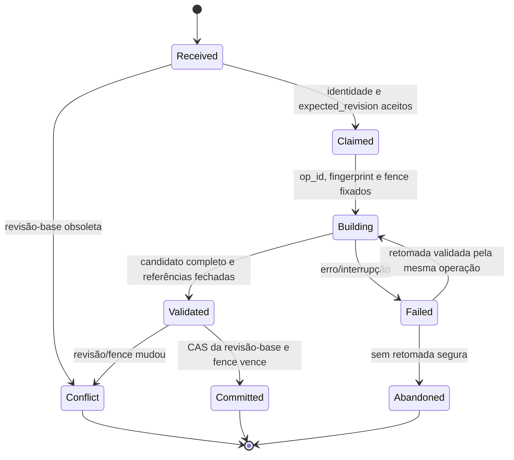

# Fase 2.1A.12B.5 — revisão do ADR-001: revisão editorial e concorrência

**Status do ADR original:** Proposed.
**Decisão nesta ficha:** REQUIRES_CLARIFICATION.
**Natureza:** análise e recomendação; não implementada nem aprovada.

## Problema e evidência

No snapshot auditado `e5bf3147a7f9a5ee02e1a011ffcbf1fb7e0cc636`, CRUD de trilhas, nós, blocos e relações altera documentos/coleções diferentes sem uma revisão monotônica comum. `snapshot_track` faz consultas separadas e compara contagens; mudança de conteúdo com cardinalidade constante pode escapar. Import e restore possuem leases próprios, sem fence comum ao CRUD. Evidências: [auditoria B.2, escritores e risco P1](./editorial-generations-phase-2-1a-12b2-audit.md), [contratos B.3](./editorial-generations-phase-2-1a-12b3-contracts.md), `backend/services/tracks.py:51-227`, `nodes.py:61-232`, `blocks.py:12-52`, `relations.py:12-50`, `versions.py:142-159,245-332` no snapshot citado.

A PoC demonstra CAS, fencing e replay em armazenamento experimental; ela recebe um snapshot do chamador e não prova que os writers reais produziram esse snapshot de uma revisão coerente. Esse limite está registrado na [comparação com a PoC](./editorial-generations-phase-2-1a-12b3-contracts.md#7-correspondencia-com-a-poc-homologada). Nenhuma evidência de implementação de revisão global foi identificada na aplicação auditada.

## Recommended Decision — recomendação técnica

Recomenda-se uma estratégia híbrida de revisão otimista, snapshots privados imutáveis e fencing para operações longas:

1. Um controle de revisão mantido pelo servidor é a autoridade de concorrência. Para o escopo inicial, a unidade é a trilha inteira, porque leitores atuais combinam trilha, árvore, relações, blocos e atividades. Alterar a unidade para subárvore exige decisão explícita de produto e provas de dependências cruzadas.
2. Uma revisão candidata deriva de uma revisão completa e identificada; não é montada por leituras livres das coleções mutáveis.
3. O servidor atribui `revision_id` e número monotônico. Um comando sem mudança semântica não deve incrementar silenciosamente a revisão; a política de no-op e auditoria precisa ser confirmada pelo domínio.
4. O comando envia `expected_revision`, `operation_id` estável e fingerprint canônico. O servidor cria e valida o candidato privado, então usa CAS condicional sobre o controle da trilha. Dois comandos da mesma revisão-base não confirmam a mesma próxima revisão: um vence e o outro recebe conflito.
5. Operações longas/retomáveis (import, build, restore e manutenção equivalente) usam lease e fence crescente. Cada etapa de validação, selagem e seleção verifica que o fence continua atual. Uma operação curta pode usar CAS sem lease, se não atravessar etapas longas.
6. Alteração editorial com base obsoleta retorna conflito explícito, recomendavelmente `409` com código estável e revisão opaca atual, sem incluir conteúdo privado. O cliente preserva seu rascunho e só reaplica após decisão explícita do editor. Não há rebase/merge silencioso.
7. Candidato parcial ou obsoleto permanece privado e não selecionável. Retry com a mesma chave e fingerprint consulta/retorna o mesmo receipt; chave igual com fingerprint diferente conflita.

O número sequencial pode ser proposto como `base_revision + 1`, mas a identidade persistida precisa também ser única e verificável. A CAS, não a leitura anterior do número, define o vencedor. Revisão semântica de taxonomias globais não cabe automaticamente no contador de uma única trilha: ADR-003 deve fornecer uma identidade versionada das dependências que entram no snapshot.

## Unidade de controle e máquina de estados

O controle único por trilha deve conter, no mínimo conceitual, revisão corrente, fence corrente e identidade da operação em curso/recente necessária à recuperação. O conteúdo completo vive em objetos privados imutáveis referenciados por esse controle. A definição de ponteiro público e sua atomicidade são do ADR-006; não duplicar a autoridade em `tracks.version` e em outro documento sem contrato de compatibilidade.

`Committed` significa que o controle aponta para a revisão imutável. Não significa que uma projeção legada de vários documentos já tenha sido atualizada. Se uma projeção de compatibilidade for necessária, ela precisa de um contrato separado de outbox/reconciliação; não pode ser tratada como parte atômica do CAS de uma revisão, nem pode ser servida parcialmente por leitores públicos.

## CAS, fencing, retry e recuperação

| Regra proposta | Consequência verificável |
|---|---|
| Filtrar o CAS por `track_id`, revisão-base esperada e fence esperado | Apenas um comando da mesma base/fence confirma; perdedores não alteram a revisão corrente |
| Candidato tem namespace/identidade próprios por operação, revisão e fence | Escrita atrasada pode no máximo deixar dados órfãos; não sobrescreve chunks de outra operação nem o head |
| Toda transição de estado valida fence e fingerprint | Um writer antigo não sela nem seleciona após takeover |
| `operation_id` identifica intenção lógica, não cada chamada de rede | Retry/replay reutiliza o mesmo ID; chamadas repetidas com conteúdo alterado são conflito |
| Receipt guarda resultado/revisão/identidade sem payload sensível | Perda de resposta pode ser recuperada sem repetir o efeito |
| Candidate não confirmado nunca é lido como revisão corrente | Falha entre chunks, validação e CAS não expõe estado parcial |

Uma operação interrompida antes do CAS pode ser retomada somente com fingerprint igual e fence ainda válido, ou após takeover que emita fence maior e revalide o candidato inteiro. Após CAS, a recuperação consulta receipt/controle e retorna o resultado já confirmado. Candidato inválido ou sem owner verificável não é completado por inferência e não é removido por GC nesta fase.

O lifetime dos receipts e das chaves idempotentes é dependência do ADR-004. “Bounded receipts” sem horizonte definido pode tornar ambíguo um retry tardio; antes de implementar, decidir qual janela é garantida, como operações expiradas são rejeitadas e como receipts usados por tentativas/histórico são preservados.

## Compatibilidade: lacuna que impede uma decisão fechada

O desenho atual recomenda revisão privada, mas não especifica como as APIs legadas e os documentos mutáveis permanecem coerentes enquanto writers são migrados. Dual-write de cada endpoint para coleções vivas e para revisões cria duas fontes e não é atômico em MongoDB standalone. Atualizar coleções vivas em sequência e só então CAS também permite leitores legados observar estado intermediário. Incrementar a revisão depois de uma escrita parcial não resolve isso.

Recomendação de transição: manter caminho legado somente para escopos ainda não migrados; instrumentar sem mudança de efeito; migrar todos os writers e readers do escopo como unidade de cutover; para o escopo migrado, a revisão imutável torna-se fonte canônica e adapters preservam contratos HTTP, mas leem/escrevem essa fonte. Se qualquer rota pública/editorial não puder deixar de usar estado vivo, não ativar o novo controle nesse escopo. Escolher manutenção/quiescência, projeção durável ou outra compatibilidade é decisão operacional e de arquitetura pendente, não uma garantia implícita deste ADR.

## Matriz de writers que precisam participar

| Writer encontrado na auditoria | Operação atual observada | Contrato/gate futuro |
|---|---|---|
| CRUD, reorder e delete de trilhas; duplicação | `tracks`, updates em loop, clone/cascade | Command/revision por agregado; exclusão depende de tombstone e ADR-004 |
| CRUD, reorder, delete e duplicação de nós | `nodes`, blocos, relações, progresso | Mesmo `expected_revision`; nenhuma mutação pública direta |
| CRUD/reordenação/exclusão de blocos | `content_blocks` | Mesmo fence; schema semântico classificado por ADR-003 e DTO por ADR-005 |
| Relações e pré-requisitos | `relations`; valida ciclo antes de gravar | Validar conjunto completo na revisão; concorrência de ciclo precisa teste |
| Publicação | snapshots, atividade, promotion de filhos e CAS final do track | ADR-006; não tratar seu CAS final como revisão editorial |
| Importação | upserts/job/lease/`_import_state` e recuperação | Mesmo fence/revisão; retry preserva `operation_id`; não dual-write |
| Restauração | delete/reinsert de coleções e job/lease | Nova revisão; ADR-006; não apagar fonte pública ativa |
| Taxonomies, tags e block types | CRUD global e `$pull` de referências | Revisão global versionada ou dependência congelada; ADR-003 |
| Seeds | inserts/set-on-insert de conteúdo e metadata | Restringir a ambientes apropriados ou passar pelo domínio revisionado |
| `manage.py`, migrations, scripts e manutenção | índices, migrations, seed, resume restore | Owner/role/escopo; quiescência ou protocolo comum; cobrir caminhos fora do processo web |

Tentativas, progresso, submissions, notas e reviews não são writers editoriais segundo a auditoria, mas precisam guardar a versão que usaram e não devem ser copiados para snapshots editoriais.

## Alternativas e trade-offs

| Alternativa | Vantagens | Custos e motivo da recomendação |
|---|---|---|
| Revisão otimista sem snapshot | Menor armazenamento e fácil adaptação de campos simples | Não compõe vários documentos em uma revisão reproduzível; insuficiente para build/editorial multi-coleção |
| Serializar todas as edições com lock/fila | Ordem simples de comandos | Contenção e recuperação do lock; não torna writes multi-documento atomicamente invisíveis a leitores legados |
| Lease/fence como único controle | Impede o processo vencido se cada escrita validar fence | Lease não prova revisão completa; escritores curtos e externos podem contornar o lease |
| Snapshot imutável por revisão sem CAS | Reproduzibilidade e isolamento do candidato | Duas revisões podem ser aceitas como corrente sem autoridade de concorrência |
| Híbrida recomendada | CAS detecta conflito; snapshot prova origem; fence protege operações longas | Maior estado, receipts, storage, métricas e migração total de writers; compatibilidade legada exige decisão própria |

## Testes e critérios de aceitação

1. Dois edits simultâneos de entidades diferentes partindo da mesma revisão: um CAS vence; o outro recebe conflito sem perder o rascunho nem alterar a revisão.
2. Alterar campo mantendo contagem de documentos: snapshot em construção é rejeitado ou aponta a revisão coerente; contagem não é prova.
3. Import × CRUD, restore × publish, reorder × edit e taxonomy × build: resultado é uma revisão inteira e apenas uma revisão-base é aceita.
4. Takeover de operação longa: worker antigo não sela nem seleciona; chunks tardios permanecem órfãos privados.
5. Perda simulada de resposta após CAS: mesma `operation_id` retorna receipt original; payload diferente conflita.
6. Falha em cada transição: nenhuma leitura pública vê candidato; retomar mantém fingerprint e fence válidos.
7. Gate de compatibilidade comprova zero writer/read path fora da revisão no escopo do cutover; teste demonstra ausência de janela em leitores públicos durante a transição.
8. MongoDB 7 standalone não recebe dependência de transação multidocumento não demonstrada.

Critério de aprovação humana: política de unidade/conflito pode ser aprovada como princípio; nenhuma implementação é liberada até escolher unidade de cutover, compatibilidade de APIs legadas, cobertura dos writers e horizonte de idempotência. Baseline ADR-008 continua pré-condição de código.

## Ficha para aprovação

* **Decisão necessária:** revisão por trilha, CAS de revisão, snapshot privado e conflito explícito são a política aceita? Qual unidade e transição cobrem todos writers sem dual-write público?
* **Recomendação:** híbrida, track inteira inicialmente, server-assigned revisions, CAS, fence em operações longas, sem rebase silencioso.
* **Alternativas:** serialização total, lease compartilhado, snapshot por revisão sem CAS, modelo híbrido.
* **Dependências:** ADR-008 para implementação; ADR-003 para metadata global; ADR-004 para receipts/retention; ADR-006 para pointer público.
* **Decisão humana:** REQUIRES_CLARIFICATION.
