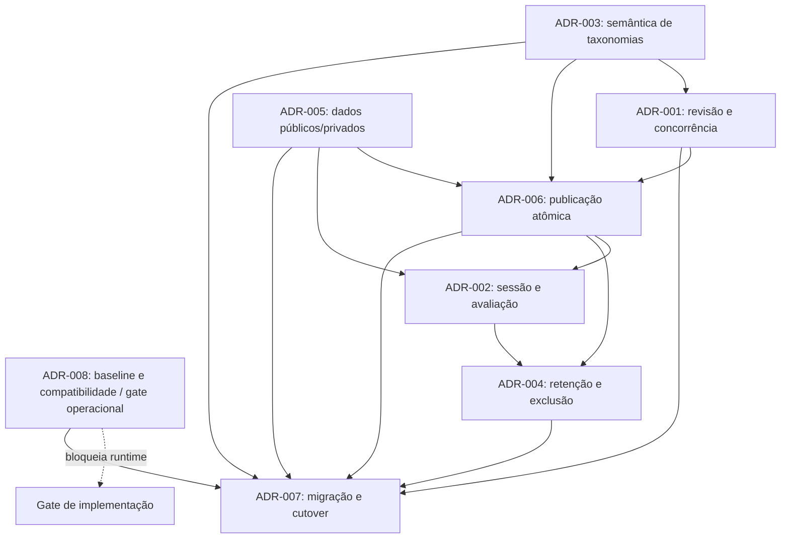

# Fase 2.1A.12B.5 — dependências, contratos e gates entre ADRs

**Status:** matriz de análise proposta; não é aprovação nem autorização de implementação.
**Baseline técnico da auditoria:** `e5bf3147a7f9a5ee02e1a011ffcbf1fb7e0cc636`.
**Fonte do estado operacional preservado:** B.4B, commit `ccc5ade1fc92f4532a820d0ade41c50555d19ffa`.

## 1. Ordem de decisão e grafo sem ciclos

Os ADRs podem ser discutidos nesta ordem; a dependência de implementação não significa que o primeiro precise ser aprovado antes da revisão conceitual dos demais.

Para evitar ciclo ADR-002 ↔ ADR-004, a primeira política provisória a revisar é **não executar GC e preservar toda geração referenciada ou de referência ainda desconhecida**. ADR-002 precisa definir quais entidades criam referências; ADR-004 decide política e elegibilidade de remoção depois do inventário. Isso é uma regra de contenção sugerida, não autorização nem prazo de retenção.

ADR-001 é dependência de ADR-006: CAS no head não corrige origem editorial inconsistente. ADR-003 fornece versões de dependências globais consumidas na candidata. ADR-005 define a fronteira de projeção/identidade. ADR-008 permanece gate paralelo de runtime: sua falta não invalida discussão conceitual, mas impede escolher baseline de execução, migração ou cutover.

## 2. Matriz de decisão transversal

| ADR | Decisão técnica proposta | Dependências de decisão | Dados/contratos afetados | Segurança e compatibilidade | Testes/gate | Responsável pela aprovação |
|---|---|---|---|---|---|---|
| 001 | Revisão server-side monotônica por agregado de trilha; snapshot coerente; CAS; fence em operações longas; conflito explícito | Escopo de agregado; ADR-003 para dependências globais; ADR-008 para baseline de implementação | Todos os comandos editoriais, import, restore, operações de revisão e receipt | Writer legado não pode atualizar head ou origem fora do controle; API precisa comunicar conflito sem perder rascunho | Corrida multi-documento, concorrência/import/restore, same-count update, fencing e retry; gate: inventário fechado de writers no escopo | Arquitetura/backend e produto para granularidade/conflito |
| 002 | Sessão de estudo fixada pelo servidor; tentativa conserva geração e definição privada original | ADR-005, ADR-006, ADR-003 e ADR-004 | Sessões, tentativas, submissões, progresso, notes/reviews e frontend | Cliente não escolhe livremente geração; política para conteúdo retirado é explícita | A→B durante sessão, resposta tardia, retomar, usuário cruzado, geração retirada; gate: decisões pedagógicas e política de sessão | Produto educacional, backend, privacidade |
| 003 | Congelar ou referenciar versão de taxonomias conforme semântica; IDs estáveis separados de rótulos/schema | Inventário do domínio e frontend; ADR-001/005/006 | Tags, taxonomies, block types e campos semânticos realmente presentes | Dependência mutável não pode mudar uma geração silenciosamente | Alterar taxonomia durante build/read; renderer histórico; gate: classificação aprovada por campo | Produto/currículo, frontend, arquitetura |
| 004 | Retenção por referência/obrigação; sem GC até inventário e política aprovados | ADR-002, ADR-006, ADR-005 | Gerações, sessões, tentativas, receipts, auditoria, PII e histórico | Exclusão/anonimização precisa respeitar referências e obrigações; recuperação auditável | Referência concorrente contra GC, holds, órfãos, restauração; gate: inventário, privacidade/jurídico e owner | Produto, privacidade/jurídico, operação |
| 005 | Defesa em profundidade: partição de dados, principals mínimos, DTO allowlist, falha fechada | Inventário de campos/endpoints; ADR-003 para taxonomias; ADR-002 para avaliador | Coleções/roles, serializers, activity API, preview, search, cache e erros | Grants atuais desconhecidos; leitor público não recebe definições de resposta; nenhum endpoint alternativo pode contornar | Negative access tests por principal/endpoint, campos extras, cache, exceção e logs; gate: threat model e inventário completo | Segurança, backend e operação de dados |
| 006 | Candidata imutável validada e selada; uma seleção CAS; reader fixa geração; sem fallback live | ADR-001 obrigatório; ADR-003/005; ADR-002 e ADR-004 para referências | Head, manifest/chunks, receipts, readers, publish/restore/cache | Atomicidade MongoDB de um documento não implica atomicidade de projeções secundárias; nenhuma fonte pública duplicada | Corrupção/falhas em cada estágio, CAS concorrente, lost response, A→B read, restore; gate: origem coerente e leitores sem bypass | Arquitetura/backend, produto para unidade de publicação, SRE |
| 007 | Rollout por escopo/flags independentes off; escritores antes de leitores; backfill sem head; sem rollback a reader inseguro | ADR-001/003/004/005/006; ADR-008 para qualquer runtime | Todas as áreas migradas, flags, métricas, backfill, legado | Dual write não é presumidamente atômico; sem fallback após cutover; rollback mantém reader versionado ou indisponibilidade | Gates por etapa, shadow divergence, bypass-zero, flags, recuperação; gate: autorização por etapa | Arquitetura, operação/SRE, produto e segurança |
| 008 | Identificar baseline implantado e escolher linha técnica/release por evidências, sem deduzir de branch | Evidência sanitizada de runtime, imagem/digest, build/commit e autorização de acesso | Schemas, serviços, frontend, jobs, build/deploy | Baseline parcial B.4B; produção não identificada; nenhuma mudança privada nesta fase | Matriz de compatibilidade com SHAs e proveniência; gate: evidência suficiente e aprovação da linha | Responsável pelo produto/engenharia e owner de infraestrutura |

## 3. Matriz de escritores reais e destino contratual

Inventário herdado da auditoria B.2 no snapshot indicado acima. “Risco” é o risco arquitetural se o caminho permanecer fora do controle; a existência atual e os arquivos devem ser reconfirmados no baseline aprovado antes de qualquer código. A matriz não afirma cobertura exaustiva de referências ainda não examinadas.

| Escritor/fluxo observado na auditoria | Efeito legado | Contrato futuro | Revisão/fence | Teste e gate | ADR/dependência |
|---|---|---|---|---|---|
| CRUD de tracks | Cria/edita/exclui dados de trilha | `EditorialRevisionContract` | Revisão da trilha; CAS em base esperada | Duas edições, conflito sem perda; todos os endpoints identificados | 001, 008 |
| CRUD de nodes | Altera estrutura e campos em documentos separados | Revision + candidate builder | Mesmo fence do agregado | Escrita concorrente em docs distintos e mesmo-count mutation | 001, 003, 006 |
| CRUD de blocks/content | Altera payload/ordem/conteúdo | Revision + builder + classificador público/privado | Revision/fence comum | Campo privado, bloco desconhecido e build concorrente | 001, 003, 005, 006 |
| Relations e reordenação | Altera árvore, dependências ou ordem | Revision contract | Mesma revisão da trilha | Ordem/hierarquia inválida em falha parcial | 001, 003, 006 |
| Questões/alternativas/respostas | Altera material avaliado e segredo de gabarito | Revision + private definition/evaluator | Revisão e fence do agregado/atividade | Gabarito não exposto; tentativa antiga usa definição antiga | 001, 002, 005, 006 |
| Tags/taxonomias/block types | Pode alterar busca, render ou semântica global | Taxonomy registry/version reference + builder | Version identity compartilhada, não apenas contador por trilha | Taxonomia muda durante build e leitura histórica | 001, 003, 006 |
| Duplicação de conteúdo | Gera novos objetos/relações | Command idempotente + revision | Nova entidade/revisão; origem fixada | Retry não duplica nem reutiliza IDs indevidos | 001, 004, 007 |
| Importação/jobs | Escrita extensa, parcial e retomável; lease específico observado | Builder/command coordinator + operation receipt | Lease/fence comum; candidato privado | Interrupção, retomada, stale worker, duplicate input | 001, 006, 007 |
| Publicação | Ativa conteúdo após preparação; auditoria localizou sequência de atualizações públicas antes de CAS | `EditorialPublicationContract` | CAS/fence contra revisão e head esperado | Falha antes/depois de cada etapa e publishers concorrentes | 001, 005, 006 |
| Restauração | Delete/reinsert de nodes/blocks/relations em lotes foi observado | `EditorialRestoreContract`, restore cria nova geração | Mesma revisão/fence e seleção CAS | Falha de lote, origem histórica, replay e leitor concomitante | 001, 004, 006 |
| Exclusão/arquivamento/admin batch | Mudanças indiretas potencialmente públicas | Command coordinator + tombstone/revision, segundo política | Revisão/fence; autorização separada | Exclusão com sessão/versão referenciada | 001, 004, 007 |
| Seeds/scripts/migrations/admin tools | Escritores fora do request path possíveis | Inventário/identidade de manutenção; não bypass silencioso | Bloqueio de publicação durante manutenção ou mesmo protocolo | Busca automatizada e auditoria de grants/processos | 001, 005, 007, 008 |
| Progresso/submissions/notes/reviews | Não são escritores editoriais, mas gravam estado de aluno | Learning/Evaluation contracts | Referência a generation/activity version; idempotência | Republicação durante tentativa/retomada | 002, 004, 005 |

Não se declara cobertura completa enquanto scripts, workers, endpoints e acesso de manutenção do baseline selecionado não forem recatalogados. Um writer residual capaz de alterar material publicável bloqueia seleção para aquele escopo.

## 4. Matriz de leitores e contratos

| Leitor observado na auditoria | Identidade/fixação futura | Projeção | Contrato | Cutover/rollback | Gate/teste |
|---|---|---|---|---|---|
| Catálogo e busca pública | Principal de leitura pública; geração/version refs fixas por resposta ou sessão | Allowlist de metadados públicos, sem campos privados | `PublicGenerationReaderContract` | Escopo por coorte; sem fallback live após seleção | DTO negative test, cache key por geração/audiência |
| Detalhe da trilha, tree, modules, nodes e blocks | ID de sessão validado pelo servidor; mesma generation ID em chamadas sucessivas | DTO versionado; rejeição de tipo/campo desconhecido | Reader + `LearningSessionContract` | Reader versionado permanece ativo ao reverter flag | Navegação A→B e ausência de mistura |
| Activity/quiz entregue ao aluno | Reader público limitado; atividade exata da geração | Sem gabarito, critério privado, hash ou metadado de writer | Reader + Activity/Evaluation | Não redirecionar tentativa antiga ao head novo | Endpoint, cache e privilégio restrito testados |
| Avaliador de resposta | Principal privilegiado somente no componente de avaliação; atividade fixada | Resultado mínimo; definição privada não retorna ao cliente | `ActivityEvaluationContract` | Não pode ser substituído por avaliação da geração atual | A definida em sessão, B publicada antes da resposta |
| Preview/versions/admin | Principal editorial autenticado e escopado | Projeção administrativa distinta e auditada | Serviço administrativo de leitura de revisão/generation | Fora da coorte pública; explicitamente autorizado | Acesso negado por papel e não contamina cache |
| Progresso/submissions/notas/reviews | Identidade do aluno; dados vinculados à tentativa/versão | Apenas dados pertencentes ao aluno/papel | `LearningSessionContract` / Evaluation | Preservar histórico; estado órfão explícito | Cross-user, replay e geração removida |
| Frontend tree/node/progress caches | Token de sessão do servidor; geração não aceita cegamente do cliente | DTOs públicos; cache segregado por geração e usuário quando pessoal | Session + Reader | Invalidate/expire explícito; sem cache cross-generation | Teste de cache A/B e cliente antigo |
| Jobs/exportações/consumidores internos | Identidade de serviço e geração/version ref explícitos | Campos necessários ao propósito, minimização | Reader interno versionado | Falha fechada e retry idempotente | Inventário de consumer e leitura em mudança de head |

Readers e consumers descobertos são os do inventário B.2. Não se deve chamar “público” a um endpoint sem confirmar autenticação, rotas alternativas, cache e identidade real no baseline escolhido.

## 5. Contradições e decisões que precisam de fechamento

| Tensão | Por que é conflito | Resolução necessária antes do runtime |
|---|---|---|
| CAS do head vs snapshot de origem | Head atômico só lineariza seleção; não torna coerentes consultas separadas em dados mutáveis | ADR-001 deve tornar revisão/snapshot coerente pré-condição de 006 |
| `tracks.version`/publicação existente vs novo head | Dois ponteiros autoritativos podem divergir e readers podem escolher heads diferentes | Definir fonte única e adaptação de compatibilidade para cada reader |
| Atividade publicada separadamente vs geração integral da trilha | `published_version_id` histórico pode permitir publicação de quiz independente, fora do head de trilha | Produto decide unidade; se atividade independente, referência versionada entra no token/manifesto da sessão |
| Dual-write legado + geração | Sem transação comum, erro entre writes produz divergência e não há source of truth único | Preferir namespace privado e cutover sem dual-write público; qualquer exceção exige ADR/contrato adicional |
| Pin de sessão vs retirada urgente | Imutabilidade para avaliação histórica pode conflitar com revogação imediata | Produto + segurança definem acesso futuro, tentativa aberta e preservação da nota |
| Retenção por referência vs prazo de sessão | GC depende de expiração; ADR-002 depende da política de ADR-004 | Não GC até ambos aprovados e grafo validado; sem prazo inventado |
| Retry idempotente vs retenção de receipt | Remover receipt pode tornar resposta perdida indistinguível de nova operação | Horizonte e resposta após expiração precisam de ADR-004; falhar/reconciliar, nunca repetir cegamente |
| Rollback operacional vs reader legado | Desativar flag e retornar ao live read pode reintroduzir risco P1 | Após cutover manter reader versionado ou parar publicação/serviço com erro controlado |
| Revisão por trilha vs taxonomia global | Contador local não vê mudança de dependência externa | Snapshot fixa versão global ou CAS valida todas dependências versionadas |
| Roadmaps com numeração duplicada | Fases antigas já atribuem 12B.5 a trabalho de runtime/instrumentação, enquanto esta fase é documental B5 | Usar nomes/escopo do trabalho, registrar colisão e renumerar somente após governança aprovar |

## 6. Invariantes, testes e severidade

Os 28 invariantes do catálogo B.3 continuam a referência normativa de teste; a tabela abaixo liga os mais relevantes às decisões sem alterar o catálogo original. Severidade indicada é de planejamento.

| Invariante resumido | ADR | Componente | Teste mínimo futuro | Gate | Severidade |
|---|---|---|---|---|---|
| Candidata deriva de revisão completa e coerente | 001/003 | revision coordinator/builder | alteração de documento e taxonomia durante snapshot, com contagem constante | Revisão comum cobre todos os writers do escopo | Crítica |
| Uma base concorrente tem no máximo um vencedor | 001/006 | control document/CAS | duas operações com mesma base, exatamente um commit | CAS e conflito testados em MongoDB descartável | Crítica |
| Escritor com fence antigo não altera estado selecionável | 001 | long-operation worker | lease takeover e late writes | todos os caminhos longos usam fence | Crítica |
| Operação repetida não duplica efeito | 001/006 | operation receipt | resposta perdida após CAS, replay idempotente | identidade/fingerprint/horizonte decididos | Alta |
| Geração selada não muda e geração incompleta não seleciona | 006 | storage/selector | corrupção/missing chunk/late write | roles e imutabilidade verificadas | Crítica |
| Reader fixa uma geração e não cai para live | 006/002 | public reader/session | A→B durante read e depois nova sessão | nenhum leitor fora do inventário/bypass | Crítica |
| Público nunca recebe resposta/definição privada | 005/002 | role, DTO, cache | tentativa de acesso por todos endpoints e principal público | grants e allowlists revisadas | Crítica |
| Tentativa avalia contra versão original | 002/005 | evaluator/progress | B publicada entre iniciar e enviar resposta A | política pedagógica e sessão aprovada | Alta |
| Backfill/shadow não altera head nem resposta | 007 | migrator/comparator | snapshot/pre-post head e respostas idênticos | autorização por escopo e flags off | Crítica |
| Geração referenciada não é coletada | 004 | retention/GC | corrida de inserir referência contra elegibilidade | grafo e política aprovados; GC off até lá | Crítica |
| Rollback não reabre leitor live inseguro | 006/007 | flags/read router | desativar seleção/reader em cada estado | recuperação testada em ambiente descartável | Crítica |
| Baseline e schema compatível têm origem explícita | 008 | build/release pipeline | teste de compatibilidade por commit/artefato escolhido | identificação/proveniência e aprovação humana | Alta |

Conjuntos futuros de teste precisam incluir unitários de contrato/projeção; integração MongoDB real descartável para índices/CAS/grants; API/auth/payload; concorrência de writers e leitores; frontend/cache; migração/backfill; segurança por identidade; rollback. Nenhum desses testes é executado na B5.

## 7. Gates consolidados

1. **G0 — baseline e destino:** ADR-008 não bloqueado por falta de evidência ou risco formalmente aceito por quem tem autoridade; linha e versão alvo escolhidas humanamente.
2. **G1 — fonte editorial:** ADR-001 aprovado; writers/consumers do escopo re-inventariados; revisão/fence não contornáveis; estratégia contra falha e retry testada.
3. **G2 — classificação e segurança:** ADR-003/005 aprovados; esquema, dados privados, grants, DTOs, logs e cache classificados.
4. **G3 — pedagogia e retenção:** ADR-002/004 aprovados para fluxos que persistem sessões, respostas, notas ou histórico; referências recuperáveis e GC bloqueado até política.
5. **G4 — publicação:** ADR-006 aprovado e depende de G1–G3; um único head/linearização, sem fallback legado e restore como nova geração.
6. **G5 — migração/cutover:** ADR-007 aprovado; backfill, coorte, observabilidade e rollback exercitados; zero writer/reader bypass no escopo.
7. **G6 — autorização de código:** uma fase específica delimita arquivos e comportamento e recebe autorização independente. Aprovação documental não satisfaz este gate.

## 8. Responsabilidade de aprovação humana

| Categoria | Decisões |
|---|---|
| Técnica/backend | Unidade de revisão, CAS, fencing, idempotência, source of truth, contracts e comportamento de erro (001, 006) |
| Segurança | Principal/roles, classificação público/privado, logging/cache, threat model e bypass legado (005, 006, 007) |
| Produto educacional | Unidade de publicação, sessão, conclusão de quiz antigo, retirada urgente, progresso e taxonomias semânticas (002, 003, 006) |
| Privacidade/jurídico | Exclusão, anonimização, retenção, preservação histórica e obrigações (004, 002) |
| Operação/infra | Baseline, identidade de imagem, compatibilidade de release, métrica, parada e cutover (008, 007) |
| Governança de engenharia | Ordem/IDs das fases, owner dos gates, autorização de implementação e política de exceções (007/008) |

Ver síntese individual em [approval packet](./editorial-generations-phase-2-1a-12b5-approval-packet.md). Nenhuma aprovação é inferida da autorização para produzir esta documentação.
