# Fase 2.1A.12B.6 — Coexistência e migração de escritores

**Status:** proposta para revisão humana; nenhum writer foi alterado.
**Snapshot observado:** `e5bf3147a7f9a5ee02e1a011ffcbf1fb7e0cc636`.

## 1. Conclusão

Instrumentar os writers antigos não basta: métricas podem revelar bypass, mas não o impedem. Dual-write endpoint a endpoint também não é seguro sem outbox/deduplicação, ordenação e recuperação formal. Recomenda-se migrar para um único caminho de comandos editoriais revisionados, mantendo a API externa inicialmente, e fazer cutover por trilha somente depois de inventariar, adaptar e bloquear todos os writers e readers daquela trilha. Onde não for possível provar cobertura, não publicar geração para aquele escopo.

Não há estado híbrido aceito em que algumas rotas gravam a origem viva e outras atualizam revisões como duas fontes de verdade. Antes do cutover, o legado continua única fonte por escopo; após cutover, revisão imutável é a fonte de verdade e caminhos antigos ficam bloqueados/sem privilégio para mutação. A transição requer janela de freeze/quiesce ou mecanismo equivalente aprovado para capturar uma base estável.

## 2. Inventário do snapshot

“Presente” abaixo quer dizer caminho de código encontrado em `e5bf…`, não confirmar que esteja implantado ou operacionalmente habilitado. Scripts externos, agendadores e versões antigas de processos não estão completamente inventariados.

| Escritor | Entidades tocadas hoje | Controle atual observado | Risco | Adaptação proposta |
|---|---|---|---|---|
| CRUD trilha (`tracks.create_track/update_track`) | `tracks` | Escrita direta; `version=0` na criação | Não serializa com filhos | Comando revisionado; sequência de revisão atribuída pelo servidor |
| Reordenação de trilhas (`tracks.reorder_tracks`) | Ordem de várias `tracks` | Várias atualizações | Escopo global, fora de um único track head | `catalog_revision` ou catálogo versionado; fixar no reader/catalog generation |
| Publicação legada (`tracks.publish_track`) | `tracks`, `nodes`, `content_blocks`, `activity_publications`, histórico | Snapshot; promotes filhos antes do update CAS da trilha | Escritas públicas pré-CAS e estado misto; CAS final não reverte efeitos anteriores | Preparar candidate privado, selar e trocar somente head único |
| CRUD/duplicação/exclusão de nós (`nodes`) | `nodes`, possivelmente filhos/referências e sequências | Atualizações/inserções/exclusões diretas; duplicação e ordenação múltiplas | Escritor indireto fora de fence comum | Adaptador HTTP → comando de revisão; duplicação é comando atômico do agregado |
| CRUD/reordenação de blocos (`blocks`) | `content_blocks` | Escrita direta e loops por IDs | Conteúdo pode mudar sem contagem mudar | COW revisionado do agregado; validar IDs/ordem |
| Relações e pré-requisitos (`relations`) | `relations` | Lerifica e depois escreve | Corrida entre validação de ciclo e insert; mudança mutável | Validar conjunto candidato completo antes do CAS; teste concorrente de ciclos |
| Taxonomias, tags, block types (`taxonomy`) | coleções globais, referências em nodes/tracks | CRUD global; `delete_tag` faz `$pull` em referências | Mudança semântica global não incrementa revisão das trilhas | Versionar catálogo/taxonomia; change só produz nova versão e dependentes fixam ID |
| Importação (`imports`, `routes_import`) | `tracks`, taxonomias/tags, nodes, blocks, relations, snapshot/import state | Lease por slug, owner checked em fases/heartbeat; writes de conteúdo sequenciais | Lease owner não é token de fence em cada write; operação pode interromper parcialmente | Import converte-se em comando que prepara candidate isolada e CAS uma revisão |
| Restauração (`versions.restore_version/apply_snapshot`) | nodes, blocks, relations, track pointer/version e job state | Lease de restore; delete/reinsert em lotes; ownership não acompanha cada mutação de conteúdo | Estado parcialmente removido/reinserido e processo stale | Restaurar = nova revisão, nova geração; nunca reescrever a geração histórica |
| Exclusão de trilha (`tracks.delete_track`) | Conteúdo, relações, progresso/eventos, atividades, estados, versões/chunks, track | Cascata sequencial | Pode remover referências necessárias; efeitos parciais | Tombstone/retirada via protocolo; política de dados e ADR-004 antes de purge |
| Tentativa/avaliação (`activities`) | `activity_attempts`, `submissions`, progresso | Chave idempotente/fingerprint; tentativa guarda `published_version_id` | Não é writer editorial; preserva avaliação de atividade, não revisão completa do track | Continua contrato separado de aluno; referenciar `generation_id` e definição privada quando aprovado |
| Progresso (`progress`) | progresso/eventos/resultados por aluno | Escrita vinculada a IDs legados e tentativa em partes | Não compõe revisão editorial; não copiar para snapshot | Manter fora do agregado editorial e introduzir referência versionada sem retarget silencioso |
| Seeds/manage/scripts | índices, catálogos e dados técnicos conforme subcomando | `manage.py` expõe seed/migrate/ensure-indexes/preflight/resume; uso em cada ambiente não comprovado | Caminho operacional pode bypassar APIs | Inventariar e restringir antes do gate; migração/maintenance precisa identidade/escopo e version control |
| Jobs/consumidores assíncronos adicionais | NÃO COMPROVADO integralmente | Repositório consultado não prova todos os schedules/deploys | Writer desconhecido invalida cobertura | Gate bloqueado até catálogo de processos implantados, schedulers e permissões |

### Leitores que condicionam o cutover

`backend/services/nodes.py:85-149` lê node/block/relation vivos e consulta `published_activity_version_id` para uma projeção de quiz. `get_track_tree` também monta árvore a partir de dados separados. Enquanto qualquer leitor público combinar coleções vivas com a geração nova, a publicação por geração não isola a resposta. `activities._publication_for_attempt` é um caso mais estreito: avalia pela versão gravada na tentativa.

## 3. Alternativas de coexistência

| Alternativa | Benefício | Problema decisivo | Avaliação |
|---|---|---|---|
| A. Instrumentar cada writer | Descobre volume e caminhos | Observabilidade não impede alteração sem fence; falsos negativos e writers offline | Necessário como etapa de inventário, insuficiente como segurança |
| B. Camada única de comandos | Uma autoridade de revisão/idempotência; conserva endpoints como adapters | Refatoração ampla, precisa migrar todos os writers e bloquear instâncias antigas | Preferida para estado revisionado |
| C. Adaptador temporário de writer legado | Pode preservar payload e reduzir mudança de callers | Se continua gravando legado e nova store, vira dual-write; se só encapsula legado, não cria imutabilidade | Aceitável apenas como adapter de API para um único command store |
| D. Bloquear operações incompatíveis | Cutover seguro quando writer não pode ser adaptado | Perda temporária de capacidade editorial ou freeze; requer UX e janela | Salvaguarda obrigatória quando cobertura incompleta |
| E. Dual-write por endpoint | Migração “em paralelo” parece gradual | Divergência, ordem diferente, crash entre commits, retry e fontes múltiplas | Rejeitada sem outbox e reconciliação formal; mesmo com outbox, requer ADR/autorização separada |

## 4. Máquina de modos proposta por escopo

```mermaid
stateDiagram-v2
  [*] --> LEGACY_ONLY
  LEGACY_ONLY --> INVENTORIED: rotas, jobs, scripts e identidades mapeados
  INVENTORIED --> WRITERS_GATED: writers antigos adaptados, drenados ou bloqueados
  WRITERS_GATED --> REVISIONED: revisão inicial coerente e CAS ativo
  REVISIONED --> SHADOW_READY: builder lê revisão imutável; sem efeito público
  SHADOW_READY --> READERS_READY: leitores, sessão e cache suportam geração
  READERS_READY --> GENERATION_ACTIVE: cutover explícito do head
  GENERATION_ACTIVE --> GENERATION_READ_ONLY: parar novas edições/publicações com leitor seguro
  GENERATION_READ_ONLY --> GENERATION_ACTIVE: retomada após gate e auditoria
```

Transição não é autorizada se existir writer desconhecido, versão antiga de processo ainda apta a gravar, credencial ampla compartilhada sem possibilidade de bloqueio, reader público sem fixação ou cache sem identidade de geração. `GENERATION_READ_ONLY` é recuperação segura preferível a fallback automático para coleções mutáveis.

## 5. Fonte da verdade e ordem de adoção

### Antes do cutover por trilha

- Legacy é fonte de verdade somente no escopo ainda integralmente legado.
- Candidate shadow é derivado/read-only do ponto de vista público e nunca modifica a resposta pública.
- Não dual-write conteúdo canônico. Comparação calcula diferença e armazena diagnóstico sanitizado.
- Inicialização de revisão exige freeze de escrita no escopo, snapshot consistente e auditoria; capturar contagens antes/depois não prova conteúdo estável.

### Depois do cutover

- O head de revisão passa a apontar a versão editorial autoritativa; `active_generation_id` é única autoridade pública.
- Todas as rotas HTTP, importações, restores, duplicações, exclusões, jobs, scripts e workers devem gravar por comandos revisionados ou ser bloqueados.
- Leitores do escopo inteiro resolvem head uma vez e usam somente generation ID fixado.
- Operação antiga com cliente DB amplo deve ser parada, drenada e/ou perder escrita via credencial/permissão antes do cutover. A auditoria atual mostra `backend/database.py:3-8` usando um cliente/banco compartilhado; papéis efetivos não foram comprovados.

## 6. Política para operação antiga e bypass

Um writer antigo não “pode coexistir” por convenção. Ele deve receber um de: (1) atualização para adapter revisionado; (2) bloqueio de rota/job; (3) retirada de permissão de escrita na store autoritativa; (4) isolamento do escopo em modo ainda legado. A simples presença de `fencing_token` em documento separado não impede processo que escreve diretamente em `tracks`, `nodes` ou `content_blocks`.

Para verificar ausência de bypass antes do cutover: inventário de rotas e dependências importáveis; varredura de writes Mongo em backend, scripts, jobs e ferramentas; identidade/role usada por cada processo; telemetria temporária de mutações por origem; teste negativo de writer antigo; prova de processo antigo drenado; auditoria do diff e configuração do deploy. Telemetria sem controle de acesso não é gate suficiente.

## 7. Compatibilidade e reversão

1. **API externa inicialmente estável:** handlers podem manter endpoint e converter pedido em comando revisionado. Resposta de conflito deve ser adicionada de forma compatível e definida com frontend; manter draft do editor.
2. **Não manter duas stores canônicas:** adapter traduz para uma fonte. Outbox transacional não pode ser assumida no standalone e seria decisão adicional.
3. **Reversão antes da ativação:** parar builder/comparator; manter legado como autoridade se nenhuma operação nova foi exposta e a origem ainda está íntegra.
4. **Reversão após ativação:** não habilitar readers/writers legados automaticamente. Parar publicação, preservar head íntegro, manter leitura por geração ou modo somente leitura/503. Voltar a legado requer prova separada de equivalência e autorização; não é rollback padrão.
5. **Divergência em shadow:** interromper avanço, preservar candidatas privadas, classificar diferenças, não selecionar ponteiro.

## 8. Gates verificáveis

| Gate | Evidência exigida | Falha implica |
|---|---|---|
| Cobertura de writers | Matriz atualizada de HTTP, jobs, scripts, seeds, import/restore, processos e roles | Permanece LEGACY_ONLY |
| Fechamento de bypass | Todos adaptados/bloqueados; teste negativo e processo antigo drenado | Não aceitar revisão central |
| Bootstrap | Freeze/quiesce documentado; revisão inicial reconciliada por IDs/refs/digests, não contagens apenas | Não criar head editorial |
| Um único store canônico | Sem dual-write sem outbox aprovado; ownership explícito | Sem shadow build derivado de origem ambígua |
| Reader fechado | Cada leitor/API/cache usa generation pin e DTO correto | Não ativar head público |
| Recoverability | Retries, órfãos privados, lost response e interrupção aprovados | Suspender comandos longos |
| Cutover | baseline e rollout aprovados (ADR-008), métricas e plano de stop | Não publicar geração |

## 9. Questões humanas e técnicas pendentes

- Produto: aceita janela de freeze e conflitos explícitos sem rebase silencioso?
- Operação: quem pode bloquear/drain jobs e revogar identidade de aplicações antigas? Baseline implantado continua parcial (ADR-008).
- Segurança: pode haver role separada por coleção/serviço ou shared credentials impedem fence efetivo?
- Engenharia: inventário completo de workers/scripts externos e identidade utilizada ainda não comprovado.
- Migração: definir escopo de coorte (por trilha) e critério de zero writers antigos; nenhuma feature flag foi aprovada.

## 10. Evidência do snapshot

- Writers CRUD/publicação: `backend/services/tracks.py:51-227`, `nodes.py:61-233`, `blocks.py:12-52`, `relations.py:12-50`, `taxonomy.py:12-91`.
- Lease/import: `backend/services/imports.py:80-175,526-699`.
- Lease/restore e aplicação de snapshot: `backend/services/versions.py:32-134,142-159,245-322`.
- Leitor agregado: `backend/services/nodes.py:85-149,234` (`get_track_tree`).
- Cliente Mongo compartilhado observado: `backend/database.py:3-8`.
- Estado de candidatas: `backend/services/immutable_publications.py:461-569`.
- Documento base: [`protocolo de revisão`](./editorial-generations-phase-2-1a-12b6-revision-protocol.md); dependências históricas: [`ADR-007 original`](./adr-editorial-generations/ADR-007-gradual-migration.md).
