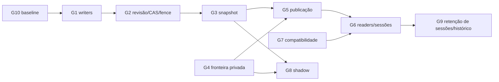

# Fase 2.1A.12B.7 — Gates técnicos e operacionais

**Status inicial:** nenhum gate foi declarado satisfeito nesta consolidação. Aprovação de princípio não é evidência de execução nem substitui aprovação técnica/operacional.

Estados permitidos: `SATISFIED`, `PARTIAL`, `NOT_VERIFIED`, `BLOCKED`. Nenhum gate abaixo é `SATISFIED`.

> A numeração G1–G10 é local desta matriz. G2 não se refere ao build GitHub Actions chamado G2 nas fases de homologação.

## 1. Matriz de gates

| Gate | Objetivo | Estado atual | Evidência exigida e critério de aprovação | Responsável pela validação | Dependências | Risco se ignorado |
|---|---|---|---|---|---|---|
| **G1 — Cobertura de escritores** | Todos os writers que afetam conteúdo/versionamento são localizados, instrumentados e validados. | `PARTIAL` | Inventário backend + rotas + scripts/seeds + jobs/workers + identidades por ambiente; evidência de eventos/mutações; testes de que cada writer passa pelo protocolo ou é bloqueado; nenhum writer desconhecido/bypass. | Backend e operação, com owner de release | Baseline/ambiente; ADR-001/007 | Writer legado muda origem sem incrementar revisão, invalidando snapshot/fence. |
| **G2 — Revisão editorial** | CAS, fencing, idempotência e conflitos são demonstrados. | `NOT_VERIFIED` | Testes concorrentes de mesma base (um winner), stale writer após takeover, replay, key/fingerprint divergentes, crash e conflito que preserva draft; nenhum rebase silencioso; concerns/topologia declarados. | Backend/persistência e QA | G1; ADR-001; G10 | Lost update, duplicação ou confirmação por operação obsoleta. |
| **G3 — Snapshot coerente** | Toda geração deriva de revisão coerente, imutável e completa. | `NOT_VERIFIED` | Origem comprometida; catálogo/taxonomias semânticas versionados; manifest/chunks íntegros; nenhuma leitura de coleções live durante builder; concorrência/revisão stale rejeitada. Contagens sozinhas não passam o gate. | Backend e QA | G1–G2; ADR-001/003/006 | Mistura de revisões ou generation parcial torna-se publicável. |
| **G4 — Fronteira público/privado** | Gabaritos e campos internos inacessíveis aos readers públicos, inclusive rotas legadas. | `PARTIAL` | DTO allowlist em todos os readers; negativas de acesso por principal; grants reais inspecionados no ambiente descartável da topologia alvo; gabaritos ausentes de API, preview não autorizado, cache, erro e log; unknown schema falha fechado. | Segurança e backend; produto classifica conteúdo learner-safe | ADR-003/005; G10 | Vazamento de resposta, definição privada, candidate ou campo adicional. |
| **G5 — Publicação atômica** | Generation completa é selecionada por um único CAS, sem head concorrente. | `NOT_VERIFIED` | Só `editorial_control.active_generation_id` é autoridade; READY implica digest/refs validados; CAS exige revisão e active head esperados; concorrentes têm um winner; falhas pré-CAS não mudam head; sem fallback live. | Backend e confiabilidade | G2–G4; ADR-006; G10 | Exposição parcial, dois heads divergentes ou seleção de candidate incompleta. |
| **G6 — Leitores e sessões** | Operação lógica e sessão usam generation fixa; tentativa avalia com definição privada original. | `PARTIAL` | Prova A→B durante tree/node/quiz/session/paginação; server-side session binding; attempt armazena generation/definition/evaluator; ID fornecido pelo cliente não autoriza acesso; cache inclui generation/audience. Tentativa versionada atual é parcial, não suficiente. | Backend, frontend, segurança e produto | G4–G5; decisões ADR-002; ADR-005/006 | Mistura de versões, nota com gabarito incorreto ou acesso cruzado. |
| **G7 — Compatibilidade** | API, frontend, progresso, schemas e operação legada funcionam na baseline alvo. | `PARTIAL` | Matriz de payload/schema contra SHA escolhido; testes de contrato/API/frontend; clientes e workers legados; plano de compatibilidade e resultado de regressão na linha de release aprovada. Comparação Git estática não comprova runtime. | Backend/frontend e owner de release | ADR-002/003/008; G10 | Implementação sobre branch/API não implantada e regressões para alunos. |
| **G8 — Migração shadow** | Build/comparação shadow não altera experiência pública nem dados canônicos. | `NOT_VERIFIED` | Builder somente escreve namespace privado; reader público não consulta; pointer/outputs de API invariáveis; comparação não guarda payload sensível; falha interrompe sem side effect. | Backend/QA/segurança | G1–G4, G7; ADR-007 | Divergência/duplicação ou shadow write com efeito público. |
| **G9 — Retenção** | Referências e política permitem preservar ou excluir de forma segura. | `BLOCKED` | Inventário de head/session/attempt/progress/history/restore/audit/receipts/holds; política e prazos aprovados por produto/privacidade/jurídico; teste de corrida/GC e recuperação. Até então, GC automático proibido. | Produto, privacidade/jurídico e operação | ADR-002/004/006 | Perda de histórico/avaliação ou retenção indevida. |
| **G10 — Baseline operacional** | Ambiente, artefato ativo, proveniência e linha de integração são comprovados. | `BLOCKED` | Evidência sanitizada, sincronizada em UTC, de serviço por ambiente, container ativo, referência/digest OCI, build/run e commit completo, rota ativa, readiness/tráfego suficiente e linha release pretendida; owner confirma baseline. | Administrador autorizado e owner de release/infra | ADR-008; handoff B.4B | Mudança no código errado, deploy incompatível ou suposição de produção falsa. |

## 2. Dependências de ativação

O diagrama mostra dependências técnicas e não autoriza sequência de execução. G9 bloqueia GC/exclusão e decisões de sessão dependentes de retenção; não se interpreta como autorização de remover dados depois de aprovado.

## 3. Regras de passagem

1. Nenhum gate passa com proposta documental, teste fake isolado ou homologação da PoC como única evidência.
2. Cada aprovação precisa apontar commit, topologia, escopo, testes, observabilidade e responsável pela revisão.
3. Cada mudança que afeta comportamento, dado, segurança, operação ou usuário tem autorização específica separada.
4. G10 precisa ser resolvido para selecionar o baseline implantado e orientar implementação na aplicação. O status de branch Git não satisfaz G10.
5. G9 permanece bloqueado até política e grafo de referências; não há GC autorizado.
6. Para cada trilha/escopo de cutover, todos os gates pertinentes precisam estar aceitos e o rollback sem fallback legado exercitado em ambiente autorizado.
